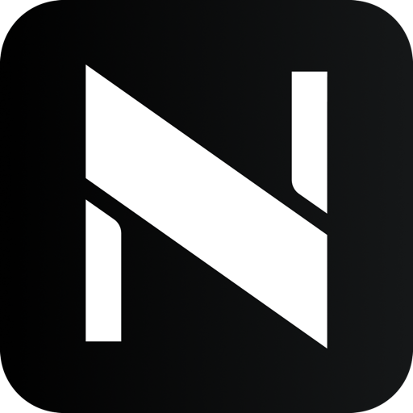

<p align="center">
  
</p>

<h1 align="center"><a href="https://github.com/mewcoder/NCode">NCode</a></h1>

<p align="center">
  精简版 AI 编程工作台 — 基于 ZCode 二次开发
</p>

NCode 是 [ZCode](https://github.com/zai-org/ZCode) 的精简定制版：**官方有的功能它都有**（自定义 API Key 供应商、会话、终端、浏览器控制、自动化、插件），在此基础上**移除官方账号体系、遥测上报和营销推广**，空闲时零出站请求。不代表 ZCode 或 Z.ai 官方产品。

**适合谁**：不需要官方账号、套餐权益和社区功能，在意隐私（无遥测）、体积与后台进程的开发者。

## 移除了什么

- **官方账号与付费体系**：账号、套餐、权益、额度查询，企业商品请求不再发起。
- **营销与社区**：邀请奖励、会话分享、社群、问题反馈入口。
- **远程工作区**：手机远控、远程设备、SSH/WSL/Docker 连接与自动恢复。
- **官方集成**：Bot / 群聊（含飞书 SDK，安装包 -11M）、闲时任务（Off-Peak）、高速卡、应用内升级、遥测上报。
- **特定插件**：搜图（image-search）、Android/iOS 模拟器不随包分发，市场目录更精简，会话不再注入无关工具声明。

移除后：空闲常驻出站请求为 0，关闭功能的专属后台进程为 0。

## 调整了什么

- 插件市场默认源改用 GitHub 官方仓库（`zai-org/zcode-plugins`）；Claude 插件市场按个人市场对待、可删除。
- 动态工作流改为 `/workflow` 命令启用（固定 onDemand 模式）。
- 新增个性化设置（全局指令编辑）与独立的数据导入入口。
- 搜索结果过滤金融分类插件。
- 全应用 NCode 品牌与图标。

功能修改、国际化文案及页面验收统一维护在 [ncode-feature.md](ncode-feature.md)；更新流程（三版实测的工作流工具链）见 `.agents/skills/ncode-upstream-update/`。更新上游后，按该清单适配当前源码。

## 兼容说明

内部包名、`zcode` 命令、`ZCODE_*` 环境变量、`.zcode` 数据目录及 `zcode://` 协议保持兼容。业务数据继续使用 `~/.zcode`；Electron 的 localStorage、Cookie 和缓存使用独立的 NCode profile，不自动迁移旧 ZCode profile。

## CLI 使用指南

模型配置、非交互调用、工具与扩展等用法见 [CLI 使用指南](apps/zcode-cli/docs/usage/README.md)。

## 快速上手

需要 Git、Node.js 24.14.0 和 pnpm 10.33.2，版本以 [mise.toml](mise.toml) 为准。在仓库根目录运行：

```sh
pnpm bootstrap
pnpm dev:desktop
```

## 本地打包

macOS arm64：

```sh
pnpm bundle:desktop -- --os mac --arch arm64
```

Windows x64：

```sh
pnpm bundle:desktop -- --os win --arch x64
```

安装包默认输出到 `packages/desktop/dist/`。

## 来源与许可

本项目基于 [ZCode 上游源码](https://github.com/zai-org/ZCode) 二次开发。许可证、版权归属和第三方声明见 [LICENSE](LICENSE) 与 [NOTICE.md](NOTICE.md)。
