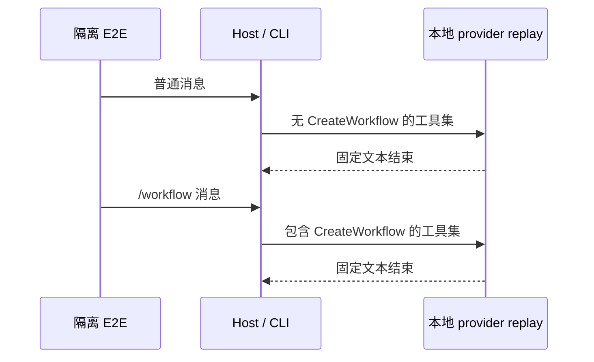

# NCode 3.16.2 补充验收（2026-10-24）

基线：`ncode-v3.16.2`，开始时 HEAD `d1c4644d`。最初范围只补充 NCode 定制改动面的验收证据；后续用户批准按特性归并本地提交，并委托决定两条用例是否转正。业务实现不变，未推送。

## 范围与判定

| 场景     | 操作                                                                   | 必须观察的结果                                                                                     |
| -------- | ---------------------------------------------------------------------- | -------------------------------------------------------------------------------------------------- |
| NWF-01   | 隔离 HOME、本地 provider replay，先发普通消息，再发 /workflow 消息     | 普通消息不暴露 CreateWorkflow；命令后暴露；两轮正常结束；不实际调用 CreateWorkflow                 |
| NHELP-01 | 既有 NCode 帮助菜单候选                                                | 首项导出日志，无孤立分隔线及官方跳转；关于窗口为 NCode，版本等于根 package.json 产品版本；保存截图 |
| 关闭项   | 运行 NCode closure anchors / E2E baseline / 固定工作流策略相关定向单测 | 关闭接线、策略值与排除清单一致，无关闭入口回流                                                     |
| 产物     | 明确 production 身份重建 macOS arm64 DMG/ZIP，执行产物审计、品牌检查   | 当前分享关闭代码进入包，19 条审计通过；图标、DMG 背景及关于窗口独立视觉核对                        |
| Web 品牌 | 本地 Web 启动并读取实际标题、favicon                                   | 标题 NCode，实际 favicon 为 N 形标识；仅品牌验收，不扩大为 Web 全链路通过                          |

唯一工作流策略所有者仍是 `NCODE_FEATURE_POLICY`；Host/CLI 沿既有配置接口消费。E2E 只通过实际输入和本地 provider 捕获观察工具集，不直接写运行时状态，也不绕过 CreateWorkflow 确认。

## 执行记录

- 首轮范围过大：`desktop-e2e-20261023-230838-341` 为 1/5 通过、4/5 失败。随后按用户明确指示，停止通用供应商/MCP 回归，撤回通用 MCP 测试修改，不追修上游通用用例。
- 供应商独立候选在第二轮已通过；该候选属于本轮收缩范围之外，已移除，不纳入 NCode 固定回归。工作流候选已收缩为上表两轮消息的最短验证，不做六次重启矩阵。
- 帮助菜单版本断言从任意数字收紧为根 package.json 产品版本。曾错误使用 Node 测试进程中未注入构建版本的共享常量，已改为直接读取产品事实源；不修改应用实现。
- 首次完整构建默认生成 Preview 测试身份，审计 19/19 通过且包含最新分享关闭代码；随后已完成正式 production 身份构建，结果见下文。
- Web 已在浏览器中确认标题 NCode，实际 data URL favicon 提取后视觉核对为 N 标识。仅运行前端时出现预期的本地 WebSocket 缺失错误；不据此宣称远控链路通过。
- 定向根 UT：4 文件 74 项通过。类型检查通过；Lint 0 errors / 87 warnings；关闭项工具清单 Node 测试 4/4 通过；品牌检查 30 资源 / 9 消费文件通过。

- 最终定向 E2E `desktop-e2e-20261023-231902-932`：NHELP-01 / NWF-01 **2/2 通过**，约 49 秒。报告：[summary.md](../../packages/desktop/.e2e-artifacts/desktop-e2e-20261023-231902-932/summary.md)。关于窗口与菜单截图已视觉核对，NCode 名称、3.16.2 版本及深色 N 标识正确。
- 候选保持 pending。`e2e-case-lifecycle` 要求 “After the user confirms human review” 后才能 promotion；本轮不请求扩充测试框架，不自动转正或 Docker 准入。

- 正式包：`ZCODE_ENV=production ZCODE_PREVIEW_IDENTITY=0` 重建 Desktop 后，复用本轮已完整准备的运行时资源打包成功。产物 `packages/desktop/dist/NCode-3.16.2-mac-arm64.dmg`（151,863,361 bytes）与 `.zip`（145,324,441 bytes，138.6 MiB）。本地构建未签名。
- 正式 `.app` 产物审计 **19/19 通过**；包内 build metadata 为 `appVersion=3.16.2`、`buildCommitId=d1c4644d`，Host bundle 含最新 `Conversation sharing is disabled in NCode` 关闭态。包内 `icon.icns` 与源文件字节一致；源图标、DMG 背景及实际 Web favicon 已视觉核对。没有实际安装或打开 DMG Finder 窗口，不能把安装后视觉项全部勾选。
- 最终 E2E 类型检查通过；根类型检查通过，Lint 0 errors / 87 warnings；架构增量检查 0 violations。业务源码未修改，未提交或推送。

没有执行全量 UT、全量桌面 E2E、Windows/Linux 包、旧模式六次重启矩阵或外部账号真实授权；这些不作为用户收缩后的 NCode 定向验收门槛。

## 夹具接入与提交归属

- 原始归属：`2825861e`（NCode 专属 E2E 目录及首个候选）。本轮把帮助菜单精确版本/截图/零模型请求断言、工作流命令启用候选、两个 case-local fixture/manifest、现有 checker 与默认 replay 的 NCode 目录接线、相关单测及本记录归入同一特性。工作流清单登记 spec、upstream fixture、case manifest 三个目录，避免下一版带入时丢失合同。
- 依赖：该原提交之前已有工作流 manifest、关闭项基线、共用 checker、回放 resolver 与桌面 helpers；归并不把后续分享实现作为前置依赖。后续 `d1c4644d` 分享关闭提交按原补丁重放；构建记录中的该 commit 是实际构建时的来源，不随历史改写伪造为新 commit。
- 先补 `upstreamReplayFixtureResolution` 回归，旧实现复现 4 项失败：NCode 漏发现进入 capture、strict 未装入本地 fixture、缺 fixture / manifest 不报错；修复后该文件及 NCode 基线/锚点共 66 项根 UT 通过，工作流清单 Node 测试 4/4 通过。两个 case 的 fixture check 通过且无警告。
- `desktop-e2e-20261023-235951-930`：未设置 `E2E_PROVIDER_REPLAY_FIXTURE_PATH`，使用 `E2E_PROVIDER_REPLAY_FIXTURE_MODE=strict-case-local` 定向运行两条 NCode pending spec，**2/2 通过**。约 30 秒执行两条 spec；包括构建的整轮报告见 [summary.md](../../packages/desktop/.e2e-artifacts/desktop-e2e-20261023-235951-930/summary.md)。
- 人工审阅、正式转正及 Docker 准入属于后续阶段；本次提交保存已经验证的 pending 合同，不把 pending 运行说成正式回归准入。

## 用户委托审阅后的正式转正

- 用户以「你决定」委托本轮审阅。Codex 阅读两个 spec、fixture 与 manifest，核对 `desktop-e2e-20261023-235951-930` 的帮助菜单及关于窗口截图，以及两轮工作流请求工具集断言，决定转正 NHELP-01 / NWF-01。此记录表示用户委托下的代理审阅，不表示用户亲自视觉验收。
- 先更新 closure spec，再给默认正式集合补断言；迁移前两条新断言按预期失败（2 failed / 5 passed）。复用既有 `runPromotionAuditTransaction` 与 helper import 重写函数，先 dry run 校验 pending 合同、正式身份及目标冲突，再把两条 spec 一次迁到 `test/e2e/ncode/`。事务内正式 fixture check、默认发现及工作流清单测试通过；fixture/manifest 内容和身份均未修改。
- 只改变两条 spec 的目录、helper 相对路径和状态说明，以及对应清单测试和文档；不扩建 promotion 框架，不修改业务实现，不进行 Docker 准入。
- 正式回放 `desktop-e2e-20261024-010650-751`：没有 `ZCODE_E2E_MANUAL_REVIEW` 或显式 fixture 路径，使用 `strict-case-local` 模式，NHELP-01 / NWF-01 **2/2 通过**，spec 执行约 48 秒。[正式回放报告](../../packages/desktop/.e2e-artifacts/desktop-e2e-20261024-010650-751/summary.md)。相关根 UT **66/66**、工作流清单 Node 测试 **4/4**、根类型检查、E2E 类型检查及架构增量检查通过；Lint **0 errors / 87 条既有 warnings**。
- freshness 检查报告相对远端落后 2 个提交，原因是此前用户批准的本地 E2E 归并及后续分享提交重放；本轮沿已验收的本地 tip 继续，不把旧远端历史合并回来。推送仍需单独授权。
