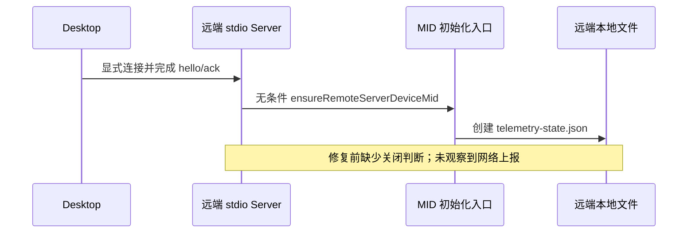

# NCode 功能关闭复查（2026-10-23）

审查对象：`ncode-v3.16.2`，HEAD `06ad1605`，包含当前未提交的本地策略改动。向前参考官方基线 `3c5b2276` 之后的账号、营销、更新、远程、工作流和遥测适配。本文是审查记录，不改变产品规则，也不表示旧提交已完成收敛或归并。

结论：已核对的正常入口和启动链路中，客户端配置、场景推荐、更新、套餐查询、远控与启动重连均受到实际控制。初审发现的远端 MID 副作用及三处旧测试现已修复，并通过本轮定向回归；下文保留修复前证据与失败记录，修复后结果见文末。后续已按用户授权整理本地特性提交；结论不扩大到未验证的安装包。

## 确认的问题

### P2（已修复）：远端 stdio Server 在关闭遥测时仍生成设备标识

- 触发：启动远端 stdio Server，完成 hello/ack；包括使用该入口的 SSH/WSL/Docker 场景。桌面自动重连关闭不会阻止后续显式连接启动 Server。
- 修复前证据：`packages/server/src/entry-stdio.ts:60` 无条件调用 `ensureRemoteServerDeviceMid`；原 `packages/server/src/stdioDeviceMid.ts:24` 至 `26` 直接调用设备标识创建函数，没有检查本地策略或上报端点。Main 和 ARMS bootstrap 已有的判断不能覆盖独立 Server 进程。
- 实测：在两个上报端点均为空的独立 tsx 进程中，调用真实 Server helper，并仅把状态目录注入临时目录中的真实 `ensureTelemetryDeviceMid`。结果为 `telemetryStateCreated=true`、`deviceMidGenerated=true`、`networkCalls=0`。临时目录已清理；没有使用真实用户状态或打印生成的标识。
- 影响：违反 `ncode-feature.md` 的“关闭时不创建设备 MID、不写遥测专属状态文件”。此次证据证明本地副作用残留，没有证明发生网络上报。
- 修复：在 `ensureRemoteServerDeviceMid` 复用两个构建期上报端点，均为空时在初始化器前返回；没有新增开关。新增用例先复现旧实现生成 MID 的失败，再验证关闭态零初始化、零文件、无告警，旧环境变量无效。分别启用任一端点的夹具保留初始化成功与失败告警回归。



### P2（已修复）：三处回归仍期待已关闭功能运行

| 修复前位置                                                                             | 当前断言                                 | 实际结果及判断                                                                                                          |
| -------------------------------------------------------------------------------------- | ---------------------------------------- | ----------------------------------------------------------------------------------------------------------------------- |
| `packages/services/test/localServicesRemoteAuthority.test.ts:402`                      | 用场景列表调用验证 transport fetch 一次  | `clientScenes=false` 后为零次。transport 集成回归应改用仍允许的请求，保留其释放验证；不能重新开启场景推荐来满足旧断言。 |
| `packages/desktop/test/desktopHostProcess.test.ts:438`                                 | Bash 完成消息触发一次 ARMS `sendCustom`  | 关闭态为零次。应分别验证关闭态不发送，以及保留实现需要的显式启用夹具。                                                  |
| `apps/zcode-cli/packages/bootstrap/tests/process-provider-registry-runtime.test.ts:90` | Standalone Provider 启动发送两次下载请求 | 官方下载装配已停用，实际零次。应验证默认使用打包配置；保留通用下载器行为时使用其独立测试边界。                          |

这些失败不能作为功能仍开启的证据；修复前的初审结果也不能报告为全通过。职责冲突已由源码和执行结果确认；本文不据此推断缺陷引入提交。

修复后的 transport 用例先断言场景读取零请求，再通过实际装配的通用 ApiClient 验证 transport 和释放。Host 用例保留非法消息拒绝与合法完成事实转发，断言关闭态不向 ARMS 发送；已有显式启用 SDK 的资源遥测测试继续验证上报映射。CLI 仅局部调整原下载用例，断言本地刷新与 Account/Config 对齐、Standalone/Worker 一致及零请求，同时拦截注入 request 与全局 fetch，防止绕过测试请求端口。

## 已核对的控制边界

| 功能                     | 实际控制点与证据                                                                                                                                                                                               | 结论及限制                                                                                                                                       |
| ------------------------ | -------------------------------------------------------------------------------------------------------------------------------------------------------------------------------------------------------------- | ------------------------------------------------------------------------------------------------------------------------------------------------ |
| `/api/v1/client/configs` | 公共服务在解析 endpoint 前返回本地快照；并发、强刷和结果隔离有关闭态回归。Main 帮助读取及动作灰度使用本地关闭结果；桌面提示不装配 fetcher；套餐服务的配置兼容方法返回本地值；预算策略方法本身返回常量。        | 当前装配无该请求。原始下载器、灰度解析器及 Provider 类仍保留，不能把保留的 URL 字符串当成实际请求，也不能只看公共服务一个入口。                  |
| `/api/v1/client/scenes`  | `clientScenesService.list` 的策略门禁返回成功空列表；真实默认策略重复读取零请求；模板和资源 hook 回归通过。                                                                                                    | 推荐与远端模板读取停止；普通 Cron 回归保留。                                                                                                     |
| 官方账号和套餐查询       | Account Source 注入空 identity，在权益解析前结束；旧团队迁移 owner 先短路；设置页、模型页及侧栏 query 的既有 `enabled` 为 false。企业查询 hook 的手动 refresh 也检查 `enabled`；购买 Provider 不挂载购买面板。 | 正常入口停止查询。通用购买、OAuth、Usage 等服务实现仍在，政策字段不是所有 RPC 方法的统一拒绝层。API Key、自定义 Provider 和通用 MCP OAuth 保留。 |
| 自动更新与强制升级       | Main 将 false 传给 `initAutoUpdater`，在注册事件、IPC、轮询和开发环境覆盖之前返回；漏改的手动菜单调用也有模块内拒绝。强更 guard 不装配，服务配置返回 null；系统命令关闭。                                      | 启动和普通手动入口被控制；构建环境及私有配置不能重开。未调用的强更辅助函数仍存在。                                                               |
| 遥测                     | 构建端点为空；Main 不加载 ARMS、不创建设备标识；上传方法在身份读取前短路，日活不创建心跳；关闭出口不入队；CLI bootstrap 剥离 OTEL/遥测环境并固定模型遥测关闭。                                                 | 网络上报关闭路径成立；远端 MID 副作用本轮已修复。未验证安装包依赖闭包。                                                                          |
| 桌面上下文提示           | Main 显式提供 true；Host spawn 在合并继承环境之后写入 `ZCODE_DESKTOP_CONTEXT_PROMPT_ENABLED=1`；服务按既有呈现面规则消费。                                                                                     | 按用户要求开启，不等待远端灰度；普通独立 Server/CLI 不扩大为 desktop。此链路核对源码，未启动完整桌面进行本轮视觉验收。                           |
| 动态工作流               | 服务快照与 Host 用户模式 resolver 都返回 `onDemand`；旧设置同步 hook 不挂载；Host gate/create/resume 策略回归通过。                                                                                            | 保留 `/workflow` 激活能力，普通消息不按 `alwaysOn` 自动激活；并非关闭整个工作流。                                                                |
| 远程启动重连             | Host 的两个启动批次都显式提供 false；集成回归执行真实入口参数，覆盖旧设置 true/false/缺省，候选枚举及重连均为零次。                                                                                            | 启动自动重连关闭；SSH/WSL/Docker 其余保留链路不作为关闭对象。                                                                                    |
| 手机远控                 | Main 使用 `createWebRemoteControlFeatureGate(false)`；start 拒绝，旧配对 restore 在读取恢复状态前返回；UI 入口隐藏。                                                                                           | relay 启动及旧状态自动恢复有实际门禁，manager 实例本身保留。                                                                                     |
| Off-Peak 与高速卡        | 公开配置返回关闭；不注册 Off-Peak 服务和工具 port，scheduler 只认领/派发 Cron；高速卡注册关闭态服务。                                                                                                          | 关闭依赖服务装配及调度入口，单改配置值不足以概括全部机制。普通 Cron 单测通过。                                                                   |
| 营销、Bot、分享与反馈    | Root 不挂载营销/OAuth/Bot effect，服务集合不装配营销、云内容或 Bot 服务；分享、反馈及官方跳转的正常 UI/命令入口移除。                                                                                          | 已沿启动装配和正常入口核对源码；保留的业务服务和协议实现不等于所有直接调用均被拒绝。本轮没有逐页面 GUI 验收。                                    |
| 内置 Provider 官方下载   | Host 不注入远程刷新 owner，独立 CLI 不注入下载装配；原始下载器无生产调用者。CLI 测试观察到零请求。                                                                                                             | 默认下载停止，旧集成回归本轮已同步并通过。                                                                                                       |
| 已安装插件面板           | `pluginPanels=installed` 后从当前插件 store 派生，暂停插件只启用，不安装/恢复；单测覆盖卸载、目标切换及迟到结果。                                                                                              | 这是已安装清单规则，不能用空远端推荐名单替代；本轮定向单测通过。                                                                                 |

## 初审执行结果（修复前）

| 验证组                                                          | 结果                                      |
| --------------------------------------------------------------- | ----------------------------------------- |
| 第一组 16 个根 UT 文件：配置、账号迁移、场景、远控/重连、面板等 | 313 通过，1 失败（场景 transport 旧断言） |
| 第二组 7 个根 UT 文件：updater、Host、Server、工作流等          | 131 通过，1 失败（PRT-010 上报旧断言）    |
| 第三组 6 个根 UT 文件：模板、资源、Cron、呈现面、关闭出口       | 56 通过                                   |
| CLI telemetry bootstrap 与 Provider runtime 两个文件            | 12 通过，1 失败（下载旧断言）             |
| Node 构建配置回归                                               | 5 通过                                    |
| 总计                                                            | 517 通过，3 失败；未运行全量测试          |
| `pnpm typecheck`                                                | 通过                                      |
| `pnpm lint`                                                     | 0 errors，87 warnings                     |
| `pnpm architecture:check --changed`                             | 0 violations                              |

初审失败的复现入口（修复后已通过）：

```sh
pnpm exec vitest run packages/services/test/localServicesRemoteAuthority.test.ts packages/desktop/test/desktopHostProcess.test.ts
pnpm --dir apps/zcode-cli exec vitest run packages/bootstrap/tests/process-provider-registry-runtime.test.ts
```

审查结论针对当前工作区源码与上述执行证据；未重新构建/安装应用，未对已安装版本做整机抓包，未执行完整桌面 GUI 验收。不能据此声称已安装包也已满足所有关闭要求。

## 修复后验证

- 根 UT 的 5 个文件共 50 项通过：Server MID、Local Services transport、Host 消息路由、显式启用夹具的资源遥测、默认关闭出口。
- CLI 的 2 个文件共 13 项通过：Provider runtime 与 telemetry bootstrap。共计 63 项通过、0 失败；没有执行全量测试。
- `pnpm typecheck` 通过；`pnpm lint` 为 0 errors、87 warnings；`pnpm architecture:check --changed` 为 0 violations。
- 独立 tsx 进程使用实际空构建端点，并设置旧启用环境变量，再调用真实 Server helper 和临时目录初始化器：初始化器调用 0 次、告警 0 次、状态文件不存在。临时目录已清理。
- 远端 MID 规则及 NC-POL-04 已同步到当前版本与 `ncode` 原版清单/spec。该修复验证时尚未提交；后续已按授权归并本地特性提交，映射见 [归属记录](ncode-feature-commit-plan-2026-10-23.md)。未推送、重建安装包或执行整机抓包。

## 历史整理后的最终验证

- 最终本地适配历史共 16 个提交：529 项根 UT（30 文件）、13 项 CLI（2 文件）及 5 项构建配置测试全部通过，共 547 项定向验证。
- `pnpm typecheck`、`pnpm verify:pre-push` 通过；预推送包含 Lint、schema、架构测试及架构检查。Lint 为 0 errors、87 warnings，架构 0 violations。
- affected 选择 2058/2058 个根测试规格，按仓库约定跳过全量 UT；不能把该阶段写成执行过全量测试。上述 547 项为另行实际执行的定向验证。
- 对 16 个中间提交执行策略依赖顺序及新增相对导入检查，8656 次相对导入解析检查无遗漏；这不是对每个中间提交运行完整类型/测试套件。
- 完整文件树在两次重排后与备份快照相同；之后仅更新本审查文档与提交映射。原版 ncode 的规则已提交，本机 skill 与两个分支的 skill 一致。未推送或重建安装包。
