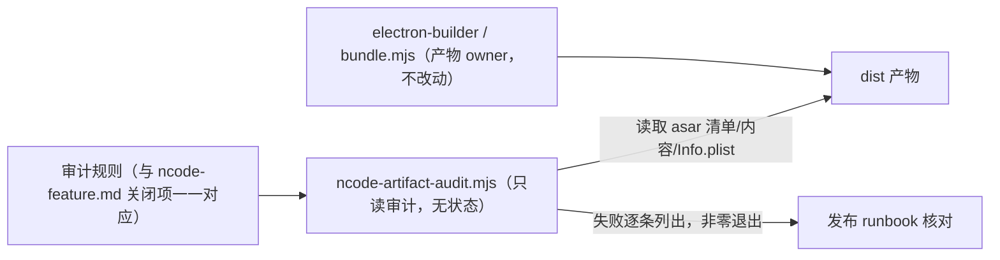

# NCode 构建产物审计与发布核对

## 产品规则

NCode 的安装包产物必须机器可验证地满足 ncode-feature.md 的关闭承诺；打包后运行一次审计，失败列出具体文件与规则，不允许「构建成功即视为纯净」。审计只读产物，不修改构建输出，不访问网络。

- **审计对象**：桌面打包产物——macOS `.app`（或 `dist/` 下的 DMG 构建树）、Windows/Linux 的 unpacked 目录。入口定位 `app.asar` 后读取其文件清单与文本内容；dist 目录存在时同时核对安装资源。
- **规则**（对应 ncode-feature.md 章节）：
  1. **遥测依赖**（关闭功能·遥测）：asar 内不得存在 `node_modules/@arms/`、`node_modules/@opentelemetry/` 运行时包及上游列出的遥测专属回放依赖。
  2. **上报端点**（关闭功能·遥测）：asar 根应用 bundle（不含 node_modules 的 `.js` 产物）不得包含遥测上报端点或 ARMS 端点地址字面量；构建期配置输出的地址必须为空。
  3. **应用内升级**（关闭功能·应用内升级）：`app-update.yml` 若存在只允许本地占位 feed，不得指向远端。
  4. **搜图插件**（关闭功能·插件商店）：关闭面是插件包与定义——asar 内条目（renderer 的插件图标注册表资产 `out/renderer/assets/` 除外）与 `Resources/glm/packages` staging 目录均不得出现 `image-search`。
  5. **品牌**（定制修改·NCode 品牌）：Renderer `index.html` 与主进程 bundle 含 N 形前景 SVG 标记（`viewBox="0 0 218 256"`）；macOS `Info.plist` 的产品名包含 NCode；dist 树存在 DMG 背景资源时核对文件在位。
  6. **关键运行时依赖**（定制修改·桌面构建依赖归属）：asar 必须携带 Main/Host 声明的外置运行时依赖（沿用 bundle 脚本既有校验清单的存在性子集），防止精简依赖时误删生产包需要的模块。
- **执行方式**：`pnpm ncode:artifact:audit -- --app <产物路径>`。规则核心为纯函数，读取器可注入；任何一条失败退出码非零并逐条列出。产物路径不存在或找不到 `app.asar` 时直接失败，不静默跳过。
- **维护**：规则与 ncode-feature.md 的关闭项对应；上游调整产物结构（路径、bundle 命名）时更新规则定位方式，不得删除规则本身。

## 发布核对（本地 runbook）

当前发布以本地构建为准；CI 与 GitHub Releases 自动化属于后续独立决策，不包含在本 spec。

1. `pnpm verify:pre-push` 通过（lint、架构检查、受影响单测）。
2. `pnpm bundle:desktop -- --os <os> --arch <arch>` 产出安装包。
3. `pnpm ncode:artifact:audit -- --app packages/desktop/dist/<产物>` 全部通过；`pnpm ncode:branding:check` 通过。
4. 按 ncode-feature.md「四、按页面验收」第 15 节记录产物核对结果；未执行的平台如实标注未验证。
5. 版本与分支：产物对应 `ncode-v<版本号>` 分支快照，验收记录回写 ncode-feature.md。

## 状态所有者与接口

- 审计脚本不拥有构建配置；依赖归属与产物组装仍由 `packages/desktop/package.json`、Vite 与 Electron Builder 决定。审计只回答「产物是否满足关闭承诺」。
- 规则核心函数导出供测试注入读取器；`scripts/test/ncode-artifact-audit.test.mjs` 用合成产物数据覆盖每条规则的通过与失败分支，不依赖真实构建。

## 验收与测试

| ID    | 场景                                | 断言                                                                  |
| ----- | ----------------------------------- | --------------------------------------------------------------------- |
| NAA01 | 合成产物满足全部规则                | 审计通过，退出码 0，输出包含每条规则的通过项                          |
| NAA02 | asar 含 @arms 或 @opentelemetry 包  | 规则 1 失败并列出命中的包路径                                         |
| NAA03 | 应用 bundle 含上报/升级端点字面量   | 规则 2/3 失败并列出命中文件与字面量                                   |
| NAA04 | 清单含 image-search 或品牌 SVG 缺失 | 规则 4/5 失败并指出位置                                               |
| NAA05 | 产物路径无效或缺 app.asar           | 整体失败并说明原因，不产生部分通过结论                                |
| NAA06 | 真实安装包审计（macOS）             | 本地 bundle 后执行一次并记录结果；未构建平台的项按 runbook 标注未验证 |
