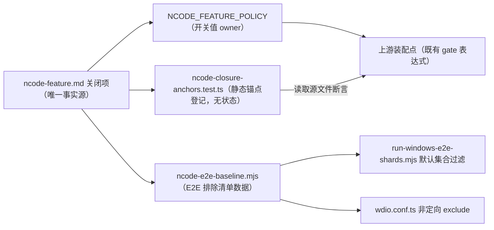

# NCode 关闭项回归套件与 E2E 基线

## 产品规则

ncode-feature.md「一、关闭功能」的每个条目至少登记一个自动化锚点；上游更新或本地改动命中锚点时，测试失败并指出对应的关闭项与清单位置，替代逐项人工排查。锚点只登记静态事实，不引入新的运行时状态、协议或依赖。

- **锚点类型**：
  - `require`：目标文件必须匹配指定正则，证明关闭接线仍然存在（如装配点的 `NCODE_FEATURE_POLICY` 门禁表达式、GitHub 插件默认源）。
  - `forbid`：目标文件必须不匹配指定正则，证明已移除的入口没有回流（如 `BotGroupDeliveryProvider` 挂载、帮助菜单孤立分隔线、`image-search` 内置定义）。
- **策略值断言**：`packages/shared/src/ncode-feature-policy/policy.js` 仍是开关值唯一来源；测试直接导入 `NCODE_FEATURE_POLICY`，断言每个关闭值为冻结的当前值，防止上游同步或误改翻转开关。
- **锚点选择**：优先 ncode-feature.md「位置」小节列出的装配点与符号；同一特性既有运行时隔离测试（如 `webRemoteControlFeatureGate.test.ts`、`hostRemoteStartupIntegration.test.ts`）又有静态锚点时，静态锚点只负责「接线仍在」，行为语义由既有测试负责，不重复断言。
- **失效处理**：上游重构导致锚点文件移动或改名时，测试报「锚点失效」并指向本 spec；由适配者沿当前调用链更新锚点与 ncode-feature.md 的位置记录，不得为通过测试删除锚点或放宽为恒真匹配。

## E2E 基线

默认全量桌面 E2E（`listDefaultFormalE2ESpecs` 与 `wdio.conf.ts` 默认 exclude 之后的集合）不包含专测已关闭功能的 spec；定向 `--spec` 运行不受限制，保留调试上游行为的能力。

- **清单**：`packages/desktop/scripts/ncode-e2e-baseline.mjs` 登记每个被排除的正式 spec 及其对应的 ncode-feature.md 关闭项；只有「断言已关闭功能存在或依赖其 mock/凭据」的 spec 才进清单。防御性引用（如 `skipOccupationOnboardingIfPresent`）与断言关闭态的 spec（如 highspeed 指示默认关闭、metric probe absence）不排除。
- **接线**：`run-windows-e2e-shards.mjs` 的默认正式集合过滤清单条目；`wdio.conf.ts` 在非定向运行时把清单 spec 加入 `exclude`，与 SSH 环境门禁（`resolveEnvironmentGatedFormalSpecExcludes`）同一模式。分片权重、manual-review 目录规则与上游 spec 选择语义不变。
- **漂移检测**：清单条目必须对应磁盘上真实存在的 spec（上游删除后清单同步清理）；默认正式集合中文件名命中关闭项特征模式（off-peak、highspeed、coding-plan、marketing-touch、bots/feishu、share-popover、官方 oauth 登录、client-config、bot worker、telemetry roles）的 spec 必须已登记，防止上游新增同类 spec 静默进入 NCode 基线。
- **部分引用 spec**：对同时覆盖保留与已关闭行为的 spec（如 help 菜单标签），整份排除并在清单 reason 标注「部分引用」；保留行为由 NCode 专属 spec 补足，帮助菜单对应下表 NHELP-01。

### NCode 专属候选的夹具合同

NCode 候选位于 `packages/desktop/test/e2e/ncode/manual-review/pending/`，只覆盖 NCode 改动。复用现有 fixture checker 与 WDIO 回放发现逻辑，不建立独立 runner。

- case-local 回放放在 `test/e2e/fixtures/upstream/ncode/<case>.json`，manifest 放在 `test/e2e/fixtures/cases/ncode/<case>.json`；两者 `spec` 均使用 `./test/e2e/ncode/<case>.test.ts` 的正式目标身份。
- checker 识别 NCode pending/formal 路径，并沿用已有身份、请求分类及 syntheticReason 校验。WDIO 从同一标准目录发现回放；strict 模式缺 manifest 或 fixture 必须失败，不以历史共享池替代。没有 fixture 的候选继续采用既有 capture 规则。
- 纯 UI 用例显式声明 `providerRequestPolicy: "none"`，保留空 case-local fixture，运行时断言 provider 捕获为空。发送消息的用例逐项登记 synthetic 请求及原因。
- 三个 NCode 目录（spec、upstream fixture、case manifest）随工作流清单整体带入下一版本。此接线不改变其他领域的目录、匹配与 capture/replay 规则。
- 候选通过截图、请求断言和夹具合同审阅后，移动到 `test/e2e/ncode/` 正式目录，修正 helper 相对路径；fixture 与 manifest 的正式身份不变。默认正式集合必须发现两条用例，pending 路径不得进入默认集合。
- 2026-10-24 用户以「你决定」委托本轮审阅；由 Codex 审阅既有截图及 strict 回放证据并决定转正，不记作用户亲自视觉验收。只转正 NHELP-01 / NWF-01，不涉及 Docker 准入。
- 复用已有 `runPromotionAuditTransaction` 与 helper 路径重写函数执行这次迁移；先 dry run，检查 pending 合同与目标冲突，再 apply。两条用例作为一次事务迁移，正式 fixture check 与默认发现检查失败时回滚；不新增 NCode runner 或通用 promotion 框架。

| Case     | Setup / Action                                    | Assert                                                   |
| -------- | ------------------------------------------------- | -------------------------------------------------------- |
| NHELP-01 | 隔离 HOME，打开帮助菜单及关于窗口                 | 仅本地工具、无分隔线；NCode 与产品版本；零 provider 请求 |
| NWF-01   | 隔离 HOME 与本地 replay，普通消息后发送 /workflow | 先无后有 CreateWorkflow；两轮正常结束，不实际调用该工具  |

验证入口：`pnpm --filter @zcode/desktop e2e:fixture:check -- --spec ./test/e2e/ncode/manual-review/pending/<case>.test.ts`；随后用相同 `--spec` 及 `ZCODE_E2E_MANUAL_REVIEW=1` 运行桌面 E2E，默认发现 case-local 回放，无需指定 fixture 环境变量。

本轮正式目标：`./test/e2e/ncode/ncode-help-menu-retained.test.ts` 与 `./test/e2e/ncode/ncode-workflow-policy.test.ts`。转正后使用正式路径执行 checker 与定向 WDIO，去掉 `ZCODE_E2E_MANUAL_REVIEW`，并以 `E2E_PROVIDER_REPLAY_FIXTURE_MODE=strict-case-local` 验证默认 case-local 回放。

## 状态所有者与接口

- 锚点测试与 E2E 基线不拥有任何产品行为；它们只把 ncode-feature.md 的关闭事实转成可执行断言。产品行为改动仍先更新 ncode-feature.md，再同步锚点或清单。
- 锚点测试位于 `packages/desktop/test/`，由根 vitest 默认入口执行；E2E 基线模块位于 `packages/desktop/scripts/`，被 runner 与 wdio 配置消费，另有 vitest 测试校验清单一致性。

## 影响映射与锚点预检

上游更新后的排查入口是 `pnpm ncode:closure:impact`：

- `--base <git-ref> [--head <git-ref>]`：以 git diff 文件清单对照全部登记（锚点、E2E 基线、品牌资源与消费文件、关键事实源），按 ncode-feature.md 章节输出受影响关闭项与处理指引；`--head` 缺省时对比工作区（覆盖在途适配）。
- `--validate`：对当前源码重放全部锚点与策略值，是 vitest 之外的快速预检（打包前、CI 可用）。
- 锚点数据登记在 `packages/desktop/scripts/ncode-closure-registry.mjs`（单一事实源），锚点测试与影响映射脚本共同消费；`matchClosureImpact` 为纯函数，测试注入合成清单覆盖分组、路径换算与无交集分支（`scripts/test/ncode-closure-impact.test.mjs`）。

## 关闭方式分类与收敛边界

按实现手段把关闭项分四类，收敛动作只在类别内评估，不跨类改造：

| 关闭方式                                  | 代表特性                                                                                                                                 | 收敛边界                                                                 |
| ----------------------------------------- | ---------------------------------------------------------------------------------------------------------------------------------------- | ------------------------------------------------------------------------ |
| 策略开关（`NCODE_FEATURE_POLICY` 消费点） | 客户端远程配置、场景推荐、官方账号查询、闲时 availability、动态工作流 onDemand、插件面板、桌面提示、远控 featureGate、自动升级 enabled   | 取值唯一来源是 policy.js；上游新增同类开关时优先接入，不另立开关         |
| 装配点固定值                              | 设置页 remoteDevices 分区过滤、Host 启动重连固定 false、node.ts 不装配 bots/highspeed/share/marketing 服务、内置 Provider 远端刷新不接入 | 无上游开关可复用时的最窄改动；保持上游实现与接口，不做第二份名单或假开关 |
| UI 入口移除                               | Bot 挂载、新手引导、帮助菜单官方分组与孤立分隔线、分享入口、Off-Peak 通知 hook                                                           | 删除即完成；回流由 forbid 锚点拦截，不恢复组件                           |
| 依赖与产物移除                            | ARMS/OpenTelemetry 生产依赖、image-search 内置插件                                                                                       | 由产物审计与构建配置保证，不以运行时开关替代                             |

2026-10 盘点结论：各关闭项的实现方式与其特性性质匹配，无需要立即改类收敛的条目；新增关闭项时按本表选择方式，并在锚点登记中体现。

## 上游回提候选

NCode 适配中产生的通用修复（与 NCode 关闭面无关，上游同样受益）；回提前需确认上游当前版本仍存在该问题，以最小通用修复形式提交，不带 NCode 语境：

| 候选                                                                                                                                  | 依据                                                                                                                           |
| ------------------------------------------------------------------------------------------------------------------------------------- | ------------------------------------------------------------------------------------------------------------------------------ |
| `fileWatcherService` 对 ENOENT 返回占位 watcher（2026-10-23，`packages/services/src/fileWatcher/fileWatcherService.ts`）              | 窗口恢复时对每个工作区 watch `.zcode/workflows`，目录缺失是常态；抛错只在 RPC 日志层留下带堆栈的 warn 噪音，调用方本就静默跳过 |
| 连接日志秘密过滤从子串替换改为完整 token 匹配（`packages/shared/src/source-server/connectionLog.ts`，architecture-policy 例外已记录） | 短密码场景可由掩码反推泄露                                                                                                     |
| 连接错误归一化补充 ECONNRESET → remote-host-unreachable（`packages/shared/src/source-server/connectionErrors.ts`）                    | 在线断连的恢复失败被误报为预检失败                                                                                             |

## 验收与测试

| ID    | 场景                                                 | 断言                                                                  |
| ----- | ---------------------------------------------------- | --------------------------------------------------------------------- |
| CLR01 | 当前源码全量运行                                     | 策略值断言、全部 require/forbid 锚点、E2E 清单一致性测试全部通过      |
| CLR02 | 模拟翻转 policy 开关或删除装配点 gate 表达式         | 对应特性锚点失败，错误信息包含特性名与 ncode-feature.md 章节引用      |
| CLR03 | 上游新增 coding-plan/off-peak 等同类正式 E2E spec    | 漂移检测失败，提示该 spec 未登记进 NCode 基线清单                     |
| CLR04 | 清单中的 spec 被上游删除或改名                       | 一致性测试失败，提示清理清单条目                                      |
| CLR05 | 定向 `--spec` 运行清单中的 spec                      | 仍可执行（不因清单被 wdio 强制排除），用于上游调试                    |
| CLR06 | `pnpm --filter @zcode/desktop test:e2e` 默认分片运行 | 默认正式集合不含清单 spec；其余 spec 集合与上游选择规则一致           |
| CLR07 | `ncode:closure:impact --base <ref>` / `--validate`   | 映射分组、路径换算、无交集分支由单测覆盖；validate 与锚点测试结论一致 |
