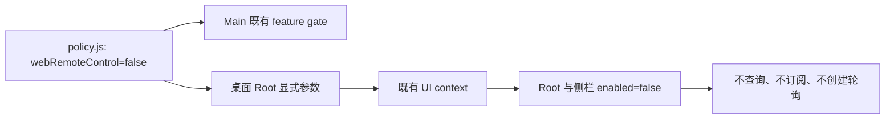
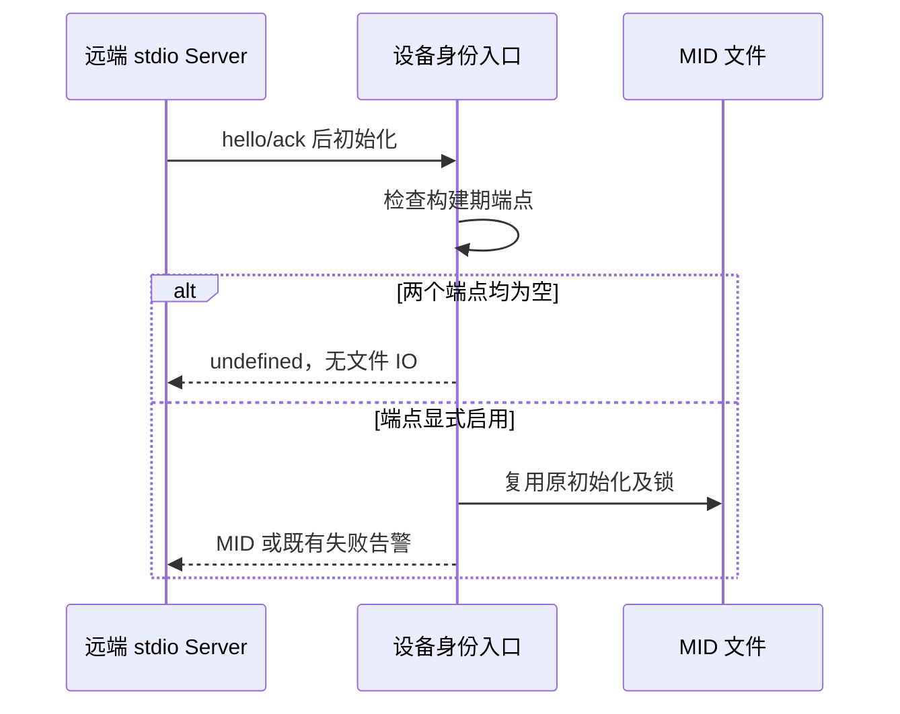
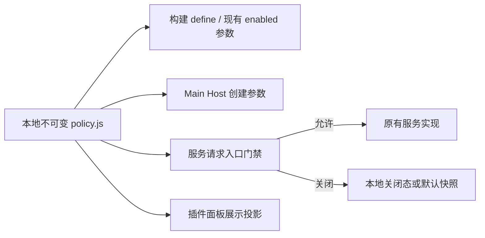
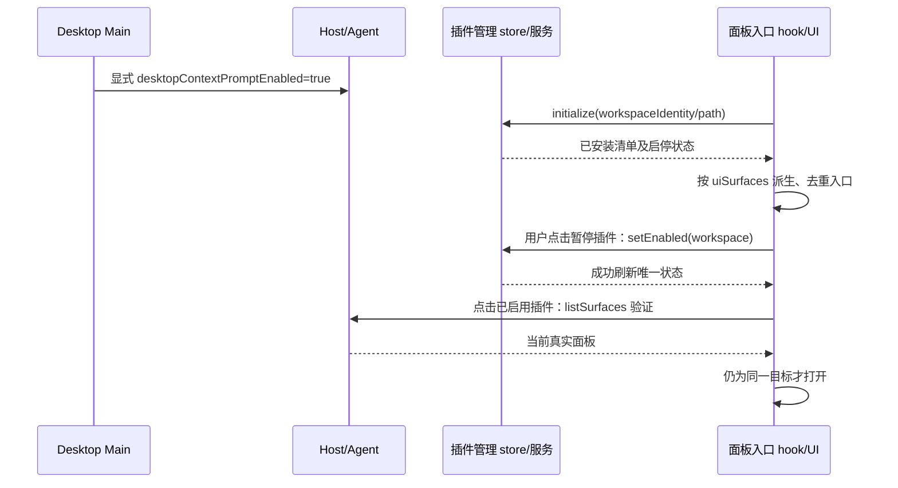

# NCode 本地客户端配置

用户决策：不再请求 `/api/v1/client/configs`；桌面上下文提示开启，插件默认排序，面板入口显示已安装插件。本文替代相关上游文档的远端灰度/推荐约定，仅适用于 NCode。

## 统一本地功能策略

`packages/shared/src/ncode-feature-policy/policy.js` 是当前仍保留控制入口的 NCode 策略唯一来源。它是不可变的本地构建配置，不读取环境变量、用户设置、远端接口，不引入运行时状态或事件。Main、Host、Renderer、Web 和构建脚本消费同一份值。

`policy.js` 为了让纯 Node 构建脚本在未构建 shared 时也能直接导入，刻意保持 JS 形式；类型对下游的可见性由同目录手写的 `policy.d.ts` 承担。原因是 `@zcode/shared` 的 exports 指向 `src/index.ts`：`apps/zcode-cli/packages/contracts` 这类**未开启 `allowJs`** 的下游项目会直接编译 shared 源码树，缺少配对声明时按 `noImplicitAny` 报 TS7016，中断 agent-cli 构建与桌面 dev。约定：声明形状与 `pnpm build` 从 `policy.js` 推断出的 `dist/ncode-feature-policy/policy.d.ts` 保持一致，字面量不收宽；新增或修改策略字段必须同步 `policy.js` 与 `policy.d.ts`，由 `packages/shared/test/ncodeFeaturePolicyDeclaration.test.ts` 守卫；不把 policy 改回 TS 源文件，那会破坏构建脚本的免构建导入。

优先复用已有开关/注入参数：桌面提示、动态工作流模式、套餐查询 hook 的 enabled、更新菜单 enabled 和构建期更新/遥测 define。原来没有开关的请求在现有服务读取入口增加门禁，保留上游具体实现，不复制请求、缓存或调度机制。已移除的组件/依赖不恢复，也不登记只能改值却无法生效的假开关。

| 策略                                            | 当前值           | 控制边界                                                                       |
| ----------------------------------------------- | ---------------- | ------------------------------------------------------------------------------ |
| remoteClientConfigs                             | false            | 公共配置强刷只返回本地默认值；Main 不再装配远端预热                            |
| officialAccountQueries                          | false            | 官方账号源身份、旧团队组织补全、侧栏/模型页套餐查询                            |
| desktopContextPrompt                            | true             | Main 创建 Host 的既有显式开关                                                  |
| webRemoteControl                                | false            | Main 运行门禁与桌面 Root 参数同源，Renderer 不查询或订阅远控状态               |
| dynamicWorkflowMode                             | onDemand         | Host 策略与公开快照使用同一模式                                                |
| offPeakAvailability                             | false            | 旧闲时配置读取返回关闭；已删除调度入口不恢复                                   |
| pluginPanels                                    | installed        | 已安装清单派生面板；可设 hidden 隐藏入口                                       |
| clientConfigDefaults                            | null / [] / null | 默认排序、空远端推荐和空漏洞链接                                               |
| clientScenes                                    | false            | 停用场景推荐及远端自动化模板，服务返回空列表；普通 Cron 手动创建与调度独立保留 |
| build.autoUpdateEnabled                         | false            | 既有更新 define 与菜单开关；已移除的更新启动装配不恢复                         |
| build.armsRumEndpoint / telemetryReportEndpoint | 空               | 既有构建期遥测禁用机制；不改变生产依赖剥离规则                                 |

审计确认：`createAccountProviderConnectionResolver` 在检查账号 identity 之前就读取 settings，后者可能运行旧团队连接迁移并请求 `/api/biz/customer/getCustomerInfo`。因此仅注入空 identity 不足以阻止这条请求，关闭官方账号查询时必须在迁移 owner 的入口短路，旧配置本地数据保持原样。

手机远控由不可变本地策略统一裁决：Main 使用 `createWebRemoteControlFeatureGate`，桌面 Renderer 向 Root 显式传入同一个值。公共 UI context 的上游默认值保留；不能以 Main 已拒绝远控为由省略 Renderer 参数，否则 Root 与侧栏仍会按默认开启值轮询 IPC。状态唯一事实源仍为 Main，Renderer 不新增缓存或关闭态副本。验收：从桌面 Root JSX 读取实际参数，挂载两个真实状态 hook 后推进时钟，查询和订阅调用为零；隔离启用时仍按原节拍查询，卸载正确释放。

远端 stdio Server 的设备身份由 `ensureRemoteServerDeviceMid` 拥有。它必须先检查既有构建期 ARMS/事件上报端点；两者为空时，在调用身份初始化器之前返回 undefined，不读写 MID 文件、不打印缺失告警，旧环境变量不能重新启用。任一端点非空的显式启用夹具仍沿用原初始化与失败告警，不另加状态或开关。

新增验收 NC-POL-01：构建配置与运行入口读取同一份策略，环境变量不能覆盖关闭值；NC-POL-02：旧团队账号迁移在策略关闭时不调用组织查询，正常 API Key/Personal Provider 本地读取保留；NC-POL-03：实际默认策略下 clientScenes 普通/重复读取均返回空列表，不请求 `/api/v1/client/scenes`；模板读取正常结束、不显示错误，不改变 Cron 手动创建、调度或工作流。

NC-POL-04：远端 Server 在空上报端点下不调用 MID 初始化器，临时目录中没有 `telemetry-state.json`，旧启用环境变量无效；单独启用任一端点的夹具验证原返回值与失败告警。关闭态 Host 消息仍校验并转发合法完成事实但不调用 ARMS；transport 回归使用独立通用请求，场景读取保持零请求；Standalone/Managed Provider 启动及 Registry 刷新不下载官方配置，打包配置与 Account revision 保持一致。

## 产品规则与接口

1. Main 不装配桌面提示远端 fetcher，不做启动预热或首 Host 灰度等待；创建本地 Host 时显式传 `ZCODE_DESKTOP_CONTEXT_PROMPT_ENABLED=1`。既有桌面附加远程服务沿用 Host 的呈现面传递，普通独立 Server/CLI 不扩大为 desktop。
2. `IClientConfigService.getSnapshot()` 保留 RPC 接口及参数校验，但只返回新建的本地快照：`{pluginStoreOrder:null, uiPluginRecommendations:[], zsrcUrl:null}`。普通/并发/forceRefresh 调用均不读取 endpoint、凭据或发送网络请求，不建立 TTL 与重试计时器。
3. Main/Web 帮助读取不请求远端配置；现有官方反馈/社群入口保持关闭。套餐、遥测、强制更新、内置 Provider 下载继续保持既有关闭装配；Off-Peak 兼容方法返回关闭和空模型视图。
4. 插件市场、办公插件预览、插件引用使用现有默认排序。市场完整目录、安装、升级仍由各自既有服务工作。
5. 面板入口读取当前工作区插件管理 store 的已安装条目及实际清单 `uiSurfaces`，不消费远端推荐。包括官方、个人、inline/开发和孤立安装；排除目录中未安装、缺包、待恢复条目。每个 `(pluginId,surfaceId)` 只出现一次，保留清单顺序。
6. 已安装但暂停的插件仍展示并复用 workspace 启用命令；入口不安装或恢复插件。运行时 `listSurfaces` 在点击时验证真实可用性后才打开面板。草稿无会话时不展示；不支持的平台/远程环境沿用既有提示与边界。

## 状态所有者和事件顺序

插件安装/启停由现有插件管理 store/服务唯一拥有；入口只是视图投影。当前 hook 只保存目标就绪和错误状态，不复制 accepted 会话、插件安装事实或面板运行时。使用包含服务、workspace identity/path、session、remote session 的目标身份隔离异步操作，旧目标迟到结果不能打开新目标或显示其错误。

不新增会话状态、持久化或重放事件；desktop continuous 与 mobile replayable 链路不变。

## 验收场景

- NC-CFG-01：桌面启动及后续 Host 创建不触发远端配置；Host env 为 `1`，不等待首次灰度。
- NC-CFG-02：公共配置普通、并发、强刷均返回本地默认，依赖请求/endpoint 解析零调用；修改返回数组不污染下次结果。
- NC-CFG-03：Web/Main 帮助及 Off-Peak 兼容读取不请求该接口，已关闭功能不复活。
- NC-CFG-04：市场、预览、引用沿用现有默认排序，强刷不拉配置。
- NC-CFG-05：已安装多面板（含个人/开发/孤立安装）逐项显示，重复去重；未安装/缺包/待恢复不显示。
- NC-CFG-06：暂停插件可以启用、失败可重试、重复点击不重复写入；卸载后随 store 更新移除；不发安装/恢复命令。
- NC-CFG-07：工作区/服务/会话切换立即隔离旧条目、错误与迟到的面板查询。
- NC-CFG-08：浏览器交互回归覆盖桌面浅色英文与窄屏深色中文：菜单及标签页显示已安装面板，启用/打开流程可用，客户端配置请求数为零。
- NC-CFG-09：`policy.d.ts` 与 `policy.js` 字段集和字面量取值一致（含嵌套 `clientConfigDefaults`、`build`），由 `ncodeFeaturePolicyDeclaration.test.ts` 纯文本比对守卫：只改 JS 不改声明必须失败，不靠人工记忆对齐。下游可编译性另行验证：`pnpm --filter @zcode/contracts build`（该项目不开启 `allowJs`）必须通过。

## 最早适配提交的复查与归并

本轮规则同时约束先前的适配提交和当前工作区，不能只检查最新的搜图插件移除提交。3.16.2 的已确认官方基线为 `3c5b2276`；后续整理从它之后第一笔 NCode 适配提交开始逐特性复查。下表记录职责归属候选，不推断缺陷由这些提交引入，也不表示已完成全范围收敛或历史归并。

| 原始特性提交                               | 本轮相关内容                                       | 整理边界                                                             |
| ------------------------------------------ | -------------------------------------------------- | -------------------------------------------------------------------- |
| `21b8e85d` 官方账号精简                    | 旧团队组织补全、侧栏及设置页套餐查询               | 按原账号职责评估补漏归并；保留 API Key、自定义 Provider 与通用 OAuth |
| `9541f661` 营销/反馈入口精简               | 帮助配置、场景推荐的残留请求                       | 检查隐藏入口后仍会运行的读取，不以 UI 隐藏代替后台停止               |
| `ae0ea836` 更新精简                        | 强更和帮助相关共享配置读取                         | 仅收敛关闭入口，不重新启用更新装配                                   |
| `0878d77c` 工作流/闲时精简                 | Off-Peak 配置、onDemand 与普通 Cron 边界           | 沿用已有模式和开关；停用推荐模板不影响普通 Cron                      |
| `a824647d` / `528127d4` 遥测精简与身份补漏 | 构建期关闭值、配置读取与设备身份边界               | 复用现有关闭机制；已移除的 SDK 与生产依赖不自动恢复                  |
| 本轮统一本地策略与已安装面板选择           | 跨特性的配置取值集中，以及用户新确定的面板展示规则 | 属于本轮新增设计，单独评估；不都归因于历史遗漏                       |

实际归并前先收敛无关改名、格式变化和过大的测试重写，并检查每组 diff 的独立验证。只在用户明确授权对应的提交、历史改写和推送后执行；未授权时保持工作区改动并提交归属建议。本轮文档同步不代表已执行历史修改。
