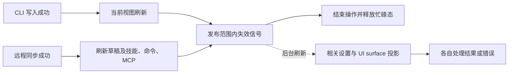
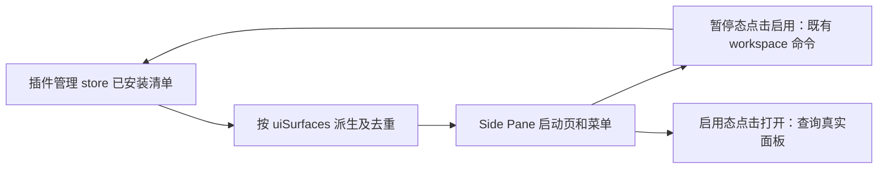

# 插件市场交互调整：实施范围

## 2026-10-22 列表样式与启停入口

市场未安装条目显示安装按钮，已安装条目在行尾常驻启停开关；悬停或键盘聚焦显示开关左侧的更多菜单，菜单仅含卸载，触屏设备常显菜单。启停复用现有配置写入与刷新流程，卸载仍需确认。详情页保留更多菜单内的启用/停用与卸载，不增加单独开关。

管理列表复用市场卡片，保持 40px 图标、标题和描述两行及相同行高，采用单列，保留“已安装”和“内置”两组。去除每行 User 默认、默认等配置来源标签，配置范围选择及继承行为不变。市场右上角“插件管理”使用正常字重的主按钮；管理标题左侧返回市场，添加左侧入口为“浏览插件市场”，替代原右上角“浏览全部插件”。

本轮不修改市场源刷新性能、旧会话能力热加载或插件图标。

## 基线与原型

- 实施基线：staging `6295a71ff38a242af5704061fea6b3947ce7241b`。
- 交互参考：`feat/side-pane-plugins-and-file-manager`，提交 `eb137c6fae42e727f139a7568a67df782446b345`。
- 产品依据：《插件市场 & Side Pane 交互调整》2026-10-09 修订，第 4–7 节。
- 本文件记录已确认的范围和实现约束，执行证据见验证矩阵。

## 2026-10-11 范围修订

用户明确要求“插件管理还是要支持按照项目管理的”。此要求优先于 PRD 中取消项目管理维度的描述。

- 插件管理保留全局 / 具体项目切换。全局安装与按项目管理同时成立。
- 全局设置提供默认启用状态与配置；项目可以覆盖启用状态与配置，并恢复继承全局设置。
- 项目内的暂停 / 启用只修改当前项目，不修改全局或其他项目；界面明确展示操作范围和配置来源。
- 卸载仍是删除全局安装，确认时说明对其他项目的影响，不能把项目暂停表达为卸载。
- 从项目进入市场时，卡片展示该项目的生效状态，暂停 / 启用写入该项目覆盖；无项目上下文时修改全局默认。
- 插件管理嵌入市场内部，复用现有插件列表与配置能力；市场内不展开独立的 MCP / Skill 设置标签。首次默认全局，往返保留选中的项目和浏览条件。

## 社区插件：收录、发布与展示

社区分段接真实目录数据；仅在没有社区条目时显示空态。分类在插件收录时完成，并贯穿目录发布、CLI 查询和客户端展示。

### 分类语义

- 官方市场是分发渠道，继续使用 `zcode-plugins-official`，其中同时收录官方插件和社区插件。
- 官方 / 社区表示插件的维护归属。外部团队、合作方和社区维护的插件归入社区；使用第三方服务的官方维护插件仍属于官方，不能根据服务品牌或作者字符串自动判定。
- `category` 继续表示用途分类，例如开发工具、生产力；UI 能力是另一独立维度，不占用用途分类或维护归属字段。
- 个人分段继续表示用户自行添加的市场和本地来源。个人来源声明自己属于官方或社区，不会使其进入 ZCode 的公开 / 社区分段。

### 插件仓库改动

1. `zcode-plugins` 中，官方维护插件保留在 `plugins/<name>`，新增外部插件收录到 `external_plugins/<name>`。目录归属是收录分类的唯一真源，不再维护第二份手工分类名单。
2. 外部提交新增插件时必须采用外部目录；对已有官方插件的修复不改变插件归属。更新贡献指南、提交模板和现有外部 PR 接收校验，在收录阶段检查目录、注册条目和用途分类。
3. 校验器、打包器、增量发布及相关测试覆盖两个插件根目录，继续拒绝路径穿越、符号链接和未登记目录。沿用现有审核与发布链路。
4. 发布器从目录归属生成每个条目的 `publisherType: "official" | "community"`，随后将 `source` 转为 CDN ZIP 地址。客户端消费发布后的字段，不依赖已被改写的源码目录路径。
5. 历史条目按维护来源逐项核对，确认属于外部维护的插件迁入外部目录。保留插件名、市场 ID、版本和产物路径；只有内容变化时才按现有规则升级插件版本。目录迁移验证 ZIP 内容及 sha256 不变，避免破坏现有安装、更新和项目配置。

### 客户端改动

- 在现有 Store Listing 类型、运行时 schema、目录解析和插件查询中贯通可选 `publisherType` 字段，不修改 `source` 的安装语义。
- 公开 = 官方市场中官方维护的插件；社区 = 官方市场中社区维护的插件；个人 = 用户自行添加的来源。
- 分类查询、精选、UI 插件专区和搜索都先限定当前分段，避免同一条目跨分段重复展示。
- UI 插件专区按条目的 `ui` 组件类型归组；内置 UI 插件（Word、PDF、PPT、表格）卸载后的可恢复条目没有运行时信息，组件类型由内置定义随官方目录与可恢复列表下发，仍留在专区而不掉进分类分组。
- 兼容旧目录：官方市场缺少归属字段时暂保留原有公开展示；内置插件明确属于官方。新发布目录必须生成完整字段，历史条目核对后随目录刷新进入正确分段。
- 不迁移用户安装目录、插件 ID 或全局 / 项目配置，不把插件归属当作执行权限或可信度等级。

## 市场调整与验收

| 调整         | 验收要求                                                                                                                  |
| ------------ | ------------------------------------------------------------------------------------------------------------------------- |
| 来源与搜索   | 默认公开；公开、社区、个人始终可切换；搜索限定当前来源，保留现有中文拼音匹配能力。                                        |
| 社区入口     | 按目录维护归属展示真实社区插件；无条目时显示“暂无社区插件”，加载失败不伪装成空态。                                        |
| 插件管理     | 顶部统一“插件管理”入口；保留全局 / 项目管理切换、项目级启停与配置覆盖；可返回“浏览全部插件”。                             |
| 管理动作     | 更多菜单仅暂停/启用、卸载；已有升级能力保留为独立操作；保留卸载确认与失败反馈。                                           |
| 安装         | 复用现有用户级安装、内置恢复、安装后技能刷新，不另建安装状态。                                                            |
| UI 插件卡片  | 整行进入详情；仅会话右侧市场多一个「打开」，暂停态显示「启用」并先启用再打开；未安装可直接安装。                          |
| 应用插件分组 | 与其他分类共用组内展开/收起，默认全部展开；超过 6 个可收起到前 6 个，不进入独立列表。搜索及清空搜索保留各来源的手动选择。 |
| UI 插件详情  | 复用普通详情布局，展示可放大效果图、界面能力与信息。                                                                      |
| 市场复用     | 主区域与 Side Pane 入口复用同一组件，市场内切换浏览 / 详情 / 管理；入口可抑制设置页面包屑。                               |

文件管理器、通用标签页多开/排序/最近关闭不属于本次市场实现范围。

## 已核实的差异

1. 原型 `useUiPluginInstall.ts` 使用 localStorage 模拟启用、暂停和移除；`DEMO_PLUGINS` 与演示页面不是可安装的真实插件包。不能以该状态报告真实安装成功。
2. 当前 `PluginStorePage.handleInstall` 已以 `user` scope 安装。管理页的 workspace/user 还承担配置覆盖与恢复继承语义，不能把删除安装范围分组等同于删除项目配置能力。
3. 原型市场同时依赖 Side Pane 的演示页面回调。直接搬运会把文件导航、演示资源和标签页改造一起带入。
4. 现有插件更新、孤立安装、内置恢复、市场刷新错误与卸载确认必须继续可用。

## 已确认的 UI 接入边界

仓库已有真实 Plugin UI 面板、`plugins/listUiSurfaces` 和沙箱运行链路。本次复用已有能力，补充目录 UI 能力标识与市场打开入口；多个 surface 时提供选择。独立推荐名单只包含已核实的真实插件，没有有效条目时使用空态，不导入原型演示状态。

发布器从清单合法的 `ui.surfaces` 生成目录 `componentTypes` 中的 `ui` 能力；CLI 将目录能力投影到未安装条目，将实际解析结果投影到已安装条目，并在插件详情协议中保留 surface 摘要。禁用不移除能力分类，运行入口仍仅允许当前项目已启用的 surface。归属、用途和 UI 能力互相独立。

打开 UI 只在会话右侧的插件市场提供：卡片、详情与管理页行的「打开 / 启用」按钮；主导航市场整行进入详情，详情主按钮为「立即试用」。桌面本地在现有会话可用时打开 UI；手机、Web 和远程可浏览、安装和管理，打开 UI 时提示暂不支持。脱离对话启动、新建会话、草稿提升和旧会话热加载留给后续任务，本轮不补这些流程。

查询视图按主机、工作区身份和配置范围隔离，复用现有管理 store 的读写逻辑。成功变更后刷新受影响视图和 UI surface 列表，丢弃旧目标迟到响应，避免主区域、Side Pane 和项目切换串状态。

全局设置投影与市场独立投影共用非阻塞变更通知；次要视图查询失败或迟迟不返回，不影响已成功写入的完成状态。通知记录操作发起时的主机、工作区和写入范围：用户级变更刷新同主机项目，项目级变更只刷新该项目的生效配置；远程同步不要求先打开全局设置。同一服务、身份和配置范围的在途查询共用结果；变更前开始的查询不能满足变更后刷新。Source 用户设置与该 Source 的项目投影使用统一主机判定，各视图分别检查目标是否仍有效并保留自己的操作错误。UI surface 订阅复用相同的主机与项目范围，不刷新无关工作区；远程同步先完成必要能力刷新，再通知派生视图。安装与内置恢复只有成功后才失效草稿并刷新技能，诊断式失败也必须显示为错误。主导航市场不提供打开 UI，管理页的“浏览全部插件”仍在市场内部切换。

已安装 UI 卡片与管理页行整行进入详情，不再提供独立“详情”按钮；查看详情不触发启用或打开，桌面、Web 和远程均可使用。默认推荐名单仍独立于安装清单，空态保留“查看所有插件”入口。推荐列表按已安装优先展示（暂停仍算已安装），组内保留配置推荐顺序；安装态刷新后重新排序，不新增安装清单外的推荐。官方市场中 `publisherType: community` 的条目在描述前显示本地化“社区”标签，个人来源自声明不获得该标签；缺少归属字段沿用公开分类。

## 状态归属

关闭视图不卸载插件。安装状态不归组件或 localStorage 独立管理。本次市场布局不改变桌面 continuous 或手机 replayable 的消息交付边界。

## 实施验证

- 先更新来源隔离、社区空态、管理往返及菜单行为测试，再修改实现。
- 插件仓库覆盖外部目录收录、目录与条目一致性、必填用途分类、非法路径拒绝、发布归属字段保留，以及历史目录迁移后的产物与安装标识稳定性。
- 客户端覆盖官方 / 社区 / 个人分段互斥、同一用途分类下不同维护归属、个人市场自声明不越界、旧目录兼容，以及目录刷新后的重新分类。
- 维护现有插件生命周期 E2E：安装、管理、暂停/启用、更新、卸载及失败场景。
- 验证项目 A 的暂停与配置不影响项目 B 或全局默认值；恢复继承后使用全局配置；项目切换不串状态；全局卸载明确提示影响范围。
- 验证桌面与手机宽度、Zai Light/Dark、中英文；保留键盘焦点与可访问名称。
- 执行架构检查、typecheck、lint、相关单测与交互 E2E。未执行项如实记录。

## 实施顺序与当前状态

先交付客户端对可选归属字段的兼容读取，再交付插件仓库收录分类、存量迁移与发布字段，两侧分别留测试及提交。插件仓库另建隔离 worktree，保留原 checkout 的已有改动。同步更新客户端领域词汇表和插件仓库贡献 / 分发文档。

已实现收录分类、发布元数据、客户端三分段与 UI 能力识别、市场内管理和 Side Pane 入口。客户端与插件仓库均使用独立 worktree，基线通过新鲜度检查。真实桌面安装、UI 沙箱、项目隔离、恢复继承和卸载通过 Electron E2E；浏览器矩阵覆盖宽窄视口、中英文与明暗主题。存量外部目录迁移保持安装 ID 与 27 个 ZIP 产物不变。目录尚未发布，默认 UI 推荐名单为空；真实手机远控及 Windows/Linux Electron 尚未验证。完整执行记录见 [验证矩阵](../testing/plugin-management-lifecycle-e2e-coverage-matrix.md)。

## 影响面核对

本轮属于 presentation、option-source、validation、commit-effect 与目录发布持久化变更。未改变对话恢复、队列与消息交付。工作树没有代码图索引，按实际导入、调用方和协议字段核对；不宣称已执行 Codegraph 深度扫描。

| 入口                         | 共享实现与展示状态                                            | 权威与提交路径                                         | 必须保持的隔离                                            |
| ---------------------------- | ------------------------------------------------------------- | ------------------------------------------------------ | --------------------------------------------------------- |
| 工作区主市场、Side Pane 市场 | PluginStorePage / ListView / Card；各视图查询、搜索与来源独立 | IPluginManagementService → CLI 安装目录与配置文件      | 工作区身份、主机、项目 / 全局配置；成功写入后刷新投影     |
| 市场内管理、设置管理         | PluginsSection；首次全局，项目选择与配置恢复沿用现有能力      | setPluginEnabled / configurePlugin / resetPluginConfig | 项目覆盖不修改全局；卸载明确为用户级全局动作              |
| UI 卡片、详情、推荐入口      | 有效清单能力；推荐名单独立；打开复用插件沙箱                  | listUiSurfaces → 原有会话的 UI runtime                 | 桌面本地才打开；旧会话 / 已卸载视图的迟到响应不打开新目标 |
| 外部收录、发布目录           | 外部目录与必填用途分类；发布生成归属与能力                    | 插件仓库 validate / sync_external_prs / build_dist     | 来源归属与用途、UI 能力分离；迁移不改安装 ID 与 ZIP 内容  |

必须检查的邻接能力是安装后的技能刷新、普通插件试用、内置恢复、孤立插件更新门禁、深链路跳转和标签标题 / 搜索。会话 frozen capability、desktop continuous、手机 replayable 与原有沙箱权限作为不变量保留。个人源不能通过自报归属进入公共或社区分段。

静态图漂移：既有分类排序节点仍有旧模式名与已安装条描述；本次登记市场与 UI 能力关系，旧模式命名不在本轮改动范围。现有界面状态由 CLI 配置和目录投影，组件不另存安装状态。

用例交接：来源与交互单测、Side Pane 浏览器回归、PLM-LC-001/002 与新增 PLM-UI-001；后者覆盖真实安装、MCP 资源与沙箱、项目隔离、恢复继承及卸载。完整执行结果以验证矩阵为准，pending 用例不自动晋级。

CLI 两个上游存量大文件原本即超过 800 行；此次仅增加目录字段与能力投影，按 CLI 规则将精确路径登记为行数告警，其他检查保持严格。

## NCode Side Pane 已安装面板

Side Pane 启动页和加号菜单不再请求客户端配置或读取服务端推荐。入口从现有插件管理 store 的实际安装清单 `uiSurfaces` 派生，包含个人来源、开发安装及孤立安装；每个 `(pluginId,surfaceId)` 去重。未安装、缺包和待恢复内置插件不展示。市场 UI 专区继续展示完整目录，使用默认排序。

- 已安装但暂停：显示“启用”，写入当前工作区覆盖。
- 已安装且启用：显示“打开”，点击后重新查询真实面板，验证后进入既有沙箱。
- 启用成功只刷新状态，再次点击打开；失败提示且可重试，不触发安装/恢复。
- 忙碌态复用插件管理 store，同插件多面板共享进度；切换目标后旧操作不提示到新目标，迟到面板响应不能打开新目标。
- 等待安装清单时显示既有骨架，无清单条目才显示空态；草稿无入口。Web、手机和远程沿用既有打开能力提示。

产品规则与 NC-CFG-05/06/07/08 验收见 [本地配置 spec](../ncode-local-client-config.spec.md)。浏览器回归使用 `packages/ui/test/browser/manual-review/pending/side-pane-plugin-menu.test.mjs`，覆盖宽窄视口、中英文、浅深主题、多面板和无客户端配置请求。
