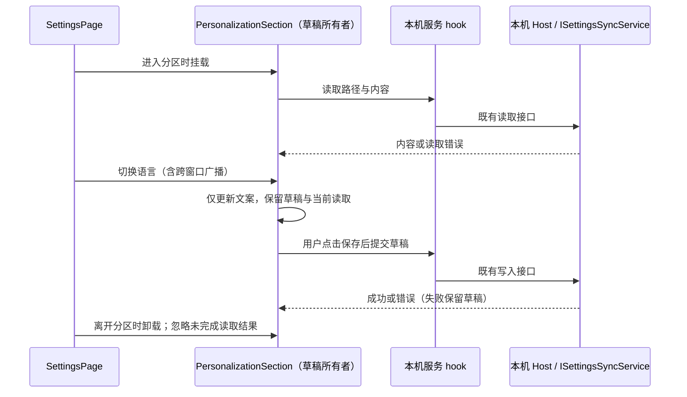

# NCode 修改清单

原版维护在 `ncode` 分支；各 `ncode-v<版本号>` 分支保存当版快照。版本更新统一使用 `ncode-upstream-update` skill，从 `ncode` 分支读取最新清单；需求、定位和验收规则的更新回写原版。

从官方最新源码建立新分支，按本文实施关闭和定制；其余功能沿用上游。产品规则随用户需求维护；上游结构变化或审查发现遗漏时，更新对应定位、实施约束和验收项。实施进度和测试结果另行记录。

本文统一记录功能修改、国际化目标文案和按页面验收清单。

## 修改原则

- 先核实上游已有的 `enabled`、模式、功能参数和构建开关；能完整控制目标行为时直接复用，由统一本地策略提供取值。没有开关或开关覆盖不全时，才在最窄的入口/装配边界补控制。入口关闭后功能已停止触发，就以该处改动完成。
- 最小修改原则同时适用于最早的适配提交和本轮未提交改动：从已确认的官方基线之后第一笔 NCode 提交开始，按特性检查完整 diff，不能只审查最新提交。旧改动中能用现有开关替代的，评估是否收敛；复查本身不授权恢复已明确移除的组件或依赖。
- 不为补漏顺带改名、重排文件或重写整套测试；保留仍有效的上游实现与回归场景，仅局部适配真正变化的行为。架构登记按实际边界要求处理，不为减少文件数绕过规则。
- 同一特性的遗留补漏与原始适配一起审查，评估是否归并到对应的原始特性提交；不机械合入最近一笔或最早一笔。新增的跨特性共用策略按独立设计评估，提交、归并和历史修改分别遵循用户授权。
- 对仍会自行运行的专属后台，按需停用初始化、请求、订阅、轮询或调度；共用服务继续承担其余功能。
- 用户调整需求时，同步更新本文对应的功能规则、文案和验收项。
- 路径和符号用于定位，文件移动后沿当前调用链查找。旧 `ncode` 分支用于参考需求和提取品牌资源，实施以当前上游结构为准。
- 当前仍有控制入口的本地策略统一维护在 `packages/shared/src/ncode-feature-policy/policy.js`，接入位置与边界见 [spec](docs/ncode-local-client-config.spec.md)。已有开关优先复用；没有开关的请求在入口门禁，保留既有实现。已移除组件/依赖继续按本文维护，不以假开关代替实际装配控制。

## 一、关闭功能

### 客户端远程配置（2026-10-23）

- **网络边界**：NCode 不请求 `GET /api/v1/client/configs`；覆盖 Main 启动/Host 创建、公共配置服务、Web 帮助配置及旧 Off-Peak 读取入口。已停用的强制升级、遥测和内置 Provider 下载装配继续保持关闭，不因本次调整重新接入。
- **桌面提示**：本地 Desktop Host 固定开启桌面上下文提示，Main 显式传递开启值；移除远端灰度预热、TTL 刷新和首 Host 的灰度等待。
- **插件排序**：公共配置服务固定返回 `pluginStoreOrder: null`，商店、插件预览和引用列表沿用既有默认排序。
- **场景推荐**：本地策略 `clientScenes: false` 停止请求 `GET /api/v1/client/scenes`，场景与自动化模板读取返回空列表；不为推荐保留后台请求。普通 Cron 的手动创建、运行和调度继续沿用原链路。
- **插件面板**：打开标签页/菜单按当前工作区插件管理 store 的已安装插件清单 `uiSurfaces` 派生入口，包含个人来源、开发安装及孤立安装；未安装、缺包、待恢复内置插件不展示。已安装但暂停的插件仍展示“启用”，启用成功后可打开；每个面板独立列出并按插件 ID/面板 ID 去重。安装与启停的唯一所有者仍为现有插件管理 store，不保存第二份名单。
- **验收**：启动、创建 Host、强刷配置、打开市场/办公预览/插件引用/标签页均不请求该接口；桌面提示开启；默认排序稳定；多面板、启停、卸载、工作区/服务切换及迟到响应隔离正确。详见 [spec](docs/ncode-local-client-config.spec.md)。

### 1. 官方账号、套餐与权益

- **界面**：隐藏官方登录、用户套餐、升级购买、领取、权益和额度提示；无可用模型时引导至 API Key/自定义 Provider 配置。
- **模型配置**：隐藏官方账号连接、Start Plan、个人/团队编程套餐导航、套餐详情与购买卡片；旧选中项回落到可见供应商；无供应商时左侧列表顶部水平居中显示“暂无供应商”，右侧显示添加供应商页面，只有实际请求未完成时显示加载状态。
- **导航所有者**：在 `ModelProviderSection.tsx` 停用套餐专属查询，在 `useModelProviderNavigation.ts` 从可见分组生成导航及默认选中；账号种类、加载状态和权益状态均不能重新生成隐藏项。通用 Provider 元数据和共享查询 hook 按上游保留，通过页面调用参数约束 NCode 的使用。
- **首页与会话空态**：隐藏编程套餐、领取和升级入口；无可用模型的中英文提示只引导配置 API Key 或自定义 Provider；隐藏首页聊天框下方的场景推荐入口。
- **侧边栏**：隐藏“升级”、套餐徽标、额度摘要及“连接使用”登录提示；偏好菜单使用 NCode 名称。保留独立的“使用统计”入口，点击时先设置既有 Usage 分区导航意图，再调用打开设置回调；没有专用回调时复用设置按钮回调。不得为恢复统计入口重新挂载套餐升级组件或启用官方额度查询。
- **帮助菜单分隔线**：帮助菜单去掉官方反馈、社群、产品文档和漏洞提交入口后，“导出日志”成为菜单首项。上游在此处有一条分隔线，用于分隔官方跳转与本地工具两组；分组消失后该线没有语义，需一并删除（[WorkspaceHelpMenuButton.tsx](packages/ui/src/WorkspaceHelpMenuButton.tsx) 的 `<DropdownMenuSeparator />`）。同类判断适用于其他“删掉分组后只剩孤立分隔线”的菜单：**先确认分隔线原本分隔的两组是否还存在**，只删线不删组或只删组不删线都会留下视觉残留。
- **后台**：检查启动登录恢复、账号 Provider 配置源、套餐查询和权益刷新；仍会自动请求的部分在其装配处停用。API Key、自定义 Provider、通用 MCP OAuth 按各自原有链路工作。
- **官方 MCP 账号链路**：停用官方账号身份头解析、凭证注入和官方 MCP 额度查询；由用户配置的 MCP 连接、凭证及通用 OAuth 继续按原流程使用。定位 [officialMcpCredentials.ts](packages/services/src/official-mcp/officialMcpCredentials.ts)、[node.ts](packages/services/src/node.ts) 的 `officialMcpCredentialSource` / `officialMcpAuthHeadersResolver`，以及 [official-auth.ts](apps/zcode-cli/packages/adapters/src/mcp/official-auth.ts) 的 `authHeadersPort.resolveHeaders` 调用与身份头注入。
- **位置**：[Root.tsx](packages/ui/src/Root.tsx)、[WelcomeScreen.tsx](packages/ui/src/WelcomeScreen.tsx)、[SettingsPage.tsx](packages/ui/src/SettingsPage.tsx)、[WorkspaceSidebarFooter.tsx](packages/ui/src/WorkspaceSidebarFooter.tsx)、[ModelProviderSection.tsx](packages/ui/src/settings/ModelProviderSection.tsx)、[model-provider-section](packages/ui/src/settings/model-provider-section/)、[SessionPane.tsx](packages/ui/src/v4/SessionPane.tsx)、[zh-CN.ts](packages/ui/src/i18n/locales/zh-CN.ts)、[en-US.ts](packages/ui/src/i18n/locales/en-US.ts)、[coding-plan-subscription](packages/services/src/coding-plan-subscription/)、[node.ts](packages/services/src/node.ts)。定位 `PRESET_PROVIDER_SPECS`、`CODING_PLAN_PROVIDER_SPECS`、`chat.error.noAvailableModel`、`sidebar.profile.notLoggedIn` 和 `ICodingPlanSubscriptionService`。

### 2. 高速卡（Highspeed）

- **界面**：隐藏高速卡领取、激活、分享和专属输入框入口，普通模型选择沿用上游。
- **后台**：检查卡片服务的构造、订阅和权益刷新；会自动运行的部分在创建处停用。
- **位置**：[highspeed UI](packages/ui/src/highspeed/)、[ConversationComposer.tsx](packages/ui/src/v4/ConversationComposer.tsx)、[SessionPane.tsx](packages/ui/src/v4/SessionPane.tsx)、[highspeed 服务](packages/services/src/highspeed/)、[node.ts](packages/services/src/node.ts)。定位 `IHighspeedCardService`。

### 3. 闲时任务（Off-Peak）

- **界面与工具**：隐藏闲时任务入口、列表和操作；自动化空态说明为“创建定时任务，按计划在后台执行。”，已有任务说明为“按计划在后台执行任务。”，英文对应值见文案清单。停止挂载 `useOffPeakTaskNotifications`；在协议创建 runtime 的位置停止注入 `offPeakPort`。
- **后台**：在共享调度器中仅停用 Off-Peak Repo 初始化、到期任务认领、派发、重试及统计采样。普通定时任务（Cron）使用原有调度链路。
- **位置**：[App.tsx](packages/ui/src/App.tsx)、[useOffPeakTaskNotifications.ts](packages/ui/src/hooks/useOffPeakTaskNotifications.ts)、[scheduler/index.ts](packages/desktop/src/scheduler/index.ts)、[server-operations.ts](apps/zcode-cli/packages/bootstrap/src/zcode-protocol/server-operations.ts)、[offpeak-port.ts](apps/zcode-cli/packages/bootstrap/src/zcode-protocol/offpeak-port.ts)、[node.ts](packages/services/src/node.ts)。定位 `IOffPeakTaskService`、`offPeakRepo.claimDue`、`offPeakPort`。

### 4. 营销、邀请与奖励

- **界面**：隐藏营销横幅、邀请活动、奖励中心和云内容弹窗。
- **后台**：入口组件及其 hook 停止挂载；检查营销服务和云内容服务的启动加载、资源预取及轮询，仅停用仍会自动运行的部分。
- **位置**：[marketing-touch UI](packages/ui/src/components/marketing-touch/)、[marketing-touch 服务](packages/services/src/marketing-touch/)、[cloud-content](packages/services/src/cloud-content/)、[node.ts](packages/services/src/node.ts)。定位 `IMarketingTouchService`、`ICloudContentService`。

### 5. 应用内升级

- **界面**：隐藏检查更新、更新通知、预览版更新、自动下载/安装和强制升级提示；处理设置页、应用菜单、命令和托盘中的对应入口。
- **后台**：在主进程启动位置停用 `initAutoUpdater` 和强制升级检查，清除相应定时检查和自动下载触发。普通应用启动、退出与重启继续使用现有生命周期。
- **位置**：[main/index.ts](packages/desktop/src/main/index.ts)、[autoUpdater.ts](packages/desktop/src/main/autoUpdater.ts)、[forceUpdateGuard.ts](packages/desktop/src/main/forceUpdateGuard.ts)、[desktopCommandHandlers.ts](packages/desktop/src/main/desktopCommandHandlers.ts)、[desktopApplicationMenu.ts](packages/desktop/src/main/desktopApplicationMenu.ts)、[desktopTray.ts](packages/desktop/src/main/desktopTray.ts)、[desktopUpdateMenu.ts](packages/ui/src/lib/desktopUpdateMenu.ts)、[settingsPageHelpers.tsx](packages/ui/src/settingsPageHelpers.tsx)。

### 6. 遥测

- **目标**：停用使用统计、行为/性能数据及错误报告的自动采集和上报；本地排错日志及会话运行事件沿用原链路。
- **修改点**：在 Main、Renderer、Host 和 CLI 的入口检查 SDK 初始化、采样定时器、订阅、上传队列及 spawn env。能从统一初始化点停用的，优先在该点处理；必填遥测接口可提供关闭态端口。
- **关闭态副作用**：SDK 和上报调用均受关闭态约束；关闭时不创建设备 MID、不写遥测专属状态文件、不读取上报所需配置。核对数据库启动报告、IPC 手动上报及远端 stdio Server 的设备身份入口，不能只检查统一 SDK 初始化。远端入口在两个构建期上报端点均为空时，必须在调用 MID 初始化器之前返回。定位 [databaseStartupTelemetry.ts](packages/desktop/src/main/databaseStartupTelemetry.ts)、[desktopMainIpcRemote.ts](packages/desktop/src/main/desktopMainIpcRemote.ts) 的 `ReportArmsCustomEvent`、[stdioDeviceMid.ts](packages/server/src/stdioDeviceMid.ts)，及 CLI `telemetry-bootstrap.ts`。
- **构建配置**：[build-time-config.mjs](scripts/build-time-config.mjs) 输出空的遥测地址、更新地址及关闭的自动升级值；环境变量或旧私有配置文件均不能重新启用。构建后的 Main、Host、Renderer 和 CLI 按各自入口核对。
- **桌面打包边界**：Main 的 ARMS 客户端由 `packages/desktop/src/telemetry/` 统一拥有，只有非空的构建期上报地址才允许加载 SDK；NCode 的地址固定为空，不能读取环境变量重开。TTFT 与动作跟踪在 Main 装配处使用无状态关闭出口：批次不入队、不导出，flush/shutdown 幂等完成；Renderer 不启动动作采集。既有协议、本地日志、崩溃文件和纯转换函数保留。ARMS / OpenTelemetry 属于开发依赖，不再由生产依赖收集、afterPack 强制注入或 bundle 缺包名单带入安装包；不得仅移除依赖而留下生产 JS 外置引用。
- **清理验收**：安装包的 Main/Host/Scheduler/Renderer/Preload 不含 ARMS 或 OpenTelemetry 运行时导入，app.asar 不携带这些依赖及专属回放依赖；无端点时不加载 SDK、不启动 Renderer 动作采集，非法或重复批次不会创建队列、文件或网络请求；正常启动、使用统计、会话事件、本地诊断与退出保持可用。
- **位置**：[appTelemetryRuntime.ts](packages/desktop/src/main/appTelemetryRuntime.ts)、[main/index.ts](packages/desktop/src/main/index.ts)、[renderer/main.tsx](packages/desktop/src/renderer/src/main.tsx)、[armsBrowserInit.ts](packages/desktop/src/shared/armsBrowserInit.ts)、[host/index.ts](packages/desktop/src/host/index.ts)、[telemetryCore.ts](packages/services/src/telemetry/telemetryCore.ts)、[telemetry-bootstrap.ts](apps/zcode-cli/packages/bootstrap/src/telemetry-bootstrap.ts)、[node.ts](packages/services/src/node.ts)。定位 `createAppTelemetryRuntime`、Arms 初始化及遥测环境注入。

### 7. 会话分享

- **界面**：隐藏会话发布、分享导入和分享链接入口，停止注册分享发布操作。
- **后台**：检查分享服务是否会在启动时建立连接、订阅或上传；仅处理入口关闭后仍会自行运行的部分。
- **位置**：[WorkspaceHeaderActionSection.tsx](packages/ui/src/WorkspaceHeaderSections/WorkspaceHeaderActionSection.tsx)、[conversation-share](packages/services/src/conversation-share/)、[host/index.ts](packages/desktop/src/host/index.ts)、[node.ts](packages/services/src/node.ts)。

### 8. 手机远控

- **界面**：隐藏手机配对和远控入口。
- **进程开关**：本地策略 `webRemoteControl: false` 同时传给 Main 的既有 feature gate 与桌面 Renderer 的 `Root.webRemoteControlFeatureEnabled`。Root 和侧栏复用已有 context / hook 的 `enabled` 门禁，不查询远控状态、不订阅状态变化、不创建一秒轮询；不修改公共 Provider 的上游默认值。
- **验收**：按桌面入口的实际参数挂载 Root/侧栏状态消费者，启动及推进时钟后状态查询、状态订阅调用均为零；显式开启的隔离测试仍能轮询并在卸载时释放订阅和计时器。普通会话、窗口标签同步及共享 Host 路由不受影响。
- **后台**：在桌面启动装配处停止创建或启动远控 manager/relay，覆盖重连、心跳和远控专属订阅；共享 Host 和协议继续由原有功能使用。
- **位置**：[main/index.ts](packages/desktop/src/main/index.ts)、[webRemoteControlManager.ts](packages/desktop/src/main/webRemoteControlManager.ts)、[web-remote-relay](packages/desktop/src/main/web-remote-relay/)、[desktopWebRemoteControlIpc.ts](packages/desktop/src/main/desktopWebRemoteControlIpc.ts)、[Root.tsx](packages/ui/src/Root.tsx)。定位 `createWebRemoteControlManager` 及启动调用。

### 9. 反馈与社群

- **界面**：隐藏帮助菜单、任务菜单、设置页及错误提示中的反馈、社群和官方产品帮助跳转。
- **后台**：反馈提交通路随入口停止触发；如反馈 SDK 有独立启动行为，再在初始化处停用。
- **挂载点**：核对 [ChatErrorBanner.tsx](packages/ui/src/ChatErrorBanner.tsx) 的错误反馈按钮，以及 [App.tsx](packages/ui/src/App.tsx) 的 `FeedbackHost`、命令面板社群入口和 `canOpenCommunity` 查询；错误详情、复制及重连继续可用。
- **位置**：[WorkspaceHelpMenuButton.tsx](packages/ui/src/WorkspaceHelpMenuButton.tsx)、[TaskActionMenuContent.tsx](packages/ui/src/TaskActionMenuContent.tsx)、[feedback](packages/services/src/feedback/)、[node.ts](packages/services/src/node.ts)。定位 `IFeedbackService` 及其 UI 调用方。

### 10. Bot / 群聊

- **界面**：隐藏 Bot 配置、群绑定、群任务和投递入口。
- **后台**：在服务装配处停止 Bot 服务、Repo、远程桥、消息订阅和后台任务的初始化。普通会话、原生子智能体和 Cron 使用各自的原有链路。
- **会话挂载**：核对 [SessionPane.tsx](packages/ui/src/v4/SessionPane.tsx) 的 `BotGroupDeliveryProvider` 及 App 的 Bot hook/操作注册；普通会话打开、切换及恢复时不查询 Bot 通道或轮询群成员。服务停用与消费者停止挂载一起完成。
- **位置**：[BotsDialog.tsx](packages/ui/src/BotsDialog.tsx)、[bots](packages/services/src/bots/)、[node.ts](packages/services/src/node.ts)、[zcodeAgentService.ts](packages/services/src/zcode-agent/zcodeAgentService.ts)、[zcodeTaskServiceAdapter.ts](packages/services/src/zcode-agent/zcodeTaskServiceAdapter.ts)。定位 `IBotsService`、`createBotsService`、`BotsRepo` 及群投递上下文。

### 11. 远程设备与远程工作区入口

- **设置页**：隐藏“远程设备”（`remoteDevices`）分区；直接导航或历史记录落到该分区时，使用现有设置导航解析回落到可见分区。
- **工作区**：隐藏 SSH/WSL/Docker 新建连接入口，停用自动连接和远程会话恢复。优先用现有入口/恢复能力判定约束调用；仍会自动执行的后台重连在触发处停用。
- **自动重连开关**：上游现有字段为 `remoteStartupAutoReconnectEnabled`，入口在 [SourceServerManagementPanel.tsx](packages/ui/src/settings/SourceServerManagementPanel.tsx)，随远程设备分区一起隐藏。Host 的 URL Server 与 Source Server 启动批次复用 [sourceServerStartupReconnect.ts](packages/desktop/src/host/sourceServerStartupReconnect.ts) 门禁，在 [host/index.ts](packages/desktop/src/host/index.ts) 装配时固定关闭；旧配置为 `true`、`false` 或缺省均不枚举候选、不建立启动连接。
- **位置**：[settingsPageConfig.ts](packages/ui/src/settings/settingsPageConfig.ts)、[settingsNavigation.ts](packages/ui/src/lib/settingsNavigation.ts)、[SettingsPage.tsx](packages/ui/src/SettingsPage.tsx)、[useRemoteConnectionEntryVisibility.ts](packages/ui/src/hooks/useRemoteConnectionEntryVisibility.ts)、[useRemoteWorkspaceHistory.ts](packages/ui/src/root/useRemoteWorkspaceHistory.ts)、[desktopRemoteSessions.ts](packages/desktop/src/main/desktopRemoteSessions.ts)。定位 `remoteDevices`、`allowRemoteWorkspaceRestore` 和启动恢复/重连调用。

### 12. 设置页新手引导入口

- **目标**：隐藏设置页的新手引导入口。
- **修改点**：移除设置侧栏中的新手引导按钮，以及常规设置中打开新手引导的按钮。
- **自动触发**：停用职业/身份问卷的自动弹出及对应引导记录查询；数据导入按钮仍打开既有导入流程。
- **位置**：[SettingsPage.tsx](packages/ui/src/SettingsPage.tsx)、[settingsPageHelpers.tsx](packages/ui/src/settingsPageHelpers.tsx)。定位文案 `settings.onboarding` 和对应按钮的打开回调。
- **启动定位**：[Root.tsx](packages/ui/src/Root.tsx)、[OccupationOnboarding.tsx](packages/ui/src/onboarding/OccupationOnboarding.tsx)、[useOnboardingTrigger.ts](packages/ui/src/onboarding/useOnboardingTrigger.ts)。定位 `onboardingEnabled`、`OccupationOnboarding` 的实际组件挂载和引导记录读取调用；保留手动数据导入使用的对话框入口。

### 13. 内置 Provider 官方配置刷新

- **目标**：内置 Provider 使用随应用打包的配置，停用官方配置检查、下载与后台刷新；本地 API Key、自定义 Provider 的保存和模型选择正常工作。
- **修改点**：在桌面 Host 的 Provider runtime 装配和独立 CLI 的刷新入口分别处理，避免 Agent 启动后重新发起刷新。
- **位置**：[node.ts](packages/services/src/node.ts)、[providerConfigRuntime.ts](packages/services/src/model-provider/providerConfigRuntime.ts)、[process-provider-registry-runtime.ts](apps/zcode-cli/packages/bootstrap/src/app/process-provider-registry-runtime.ts)、[provider-runtime-env.ts](apps/zcode-cli/packages/cli/src/provider-runtime-env.ts)。定位 `zcodeBuiltinEnvironment`、`fetchZCodeBuiltinRemoteRelease` 和 `zcodeBuiltinRemote`。

### 14. 插件商店来源与分类

- **市场来源**：默认 `zcode-plugins-official` 使用 `zai-org/zcode-plugins` GitHub 仓库源，沿用现有 Archive/Git 获取链路；不能只换成 raw JSON，因为目录里的插件 source 是相对路径。只自动迁移该市场已保存的旧默认 CDN 地址，清除旧刷新状态，自定义来源保持原样；保留市场 id、内置插件、安装身份和用户配置。源码源不包含 UI 插件编译产物，图标仍遵循上游目录地址。
- **默认市场**：不自动注册 Claude 插件市场；已有来源和已安装插件保留。
- **公开与社区**：解析官方市场源码目录时，为缺少 `publisherType` 的条目按直接目录 `plugins/<name>` / `external_plugins/<name>` 补齐公开/社区归属；接受可选 `./` 前缀与结尾 `/`。显式字段优先，已有缓存同样生效；其他市场、未知路径、嵌套或越级路径不推断。仅补充展示字段，不改变插件身份或权限。
- **目录合并**：插件 adapter 继续拥有市场记录与目录；仓库刷新后保留应用生成的 bundled/remote 两个分片及合并目录，仓库同名文件不能替换本地分片。远端同名条目优先，重复刷新、应用重启及内置播种后目录不丢失，网络失败保留已有缓存。
- **内置搜图插件**：不内置、不打包 `image-search`，默认启用集合不含 `image-search@zcode-plugins-official`；商店目录、已安装管理及可恢复内置插件中均不出现该条目。移除官方 definition 与默认启用 id，并同步桌面 staging、CLI SEA 和远端 Agent 产物清单；已有本地缓存不再播种，旧配置中的同名条目不影响启动。
- **目标**：在商店浏览、搜索、分类及精选中隐藏金融（`finance`）分类插件。
- **修改点**：在商店列表生成各类展示结果前统一过滤；已安装插件仍可从管理页停用或卸载。
- **位置**：默认来源在 [plugin-marketplaces.ts](packages/shared/src/plugin-marketplaces.ts)；登记、迁移与条目解析在 [marketplace.ts](apps/zcode-cli/packages/adapters/src/plugins/marketplace.ts)，定位 `ensureDefaultPluginMarketplaces`、`fillOfficialPublisherType`；分片合并在 [official-marketplace.ts](apps/zcode-cli/packages/adapters/src/plugins/official-marketplace.ts)。商店投影在 [PluginStoreListView.tsx](packages/ui/src/settings/PluginStoreListView.tsx)、[pluginStoreListing.ts](packages/ui/src/settings/pluginStoreListing.ts)，定位 `resolvePluginStoreSegment`、`resolveStoreCategory`。搜图移除在 [official-plugin-definitions.ts](apps/zcode-cli/packages/bootstrap/src/app/official-plugin-definitions.ts)、[prepare-agent-node-bundle.mjs](packages/desktop/scripts/prepare-agent-node-bundle.mjs)、[sea-official-plugin-assets.mjs](apps/zcode-cli/packages/cli/scripts/sea-official-plugin-assets.mjs)、[zcodeAgentOfficialPluginAssets.ts](packages/server/src/remote/zcodeAgentOfficialPluginAssets.ts)。

## 二、定制修改

### 1. NCode 品牌

- **名称与说明**：公开产品名使用 NCode，README 按下方“README 更新”条目维护。桌面显示名通过 [desktop-product-identity.mjs](packages/desktop/scripts/desktop-product-identity.mjs) 调整，再核对 [electron-builder.config.js](packages/desktop/electron-builder.config.js) 的产物名称与图标引用。内部包名、命令、`~/.zcode` 业务数据目录和协议标识沿用兼容身份；Electron profile 使用独立的 NCode 目录，不自动迁移旧 profile。
- **资源来源**：参考 `9740464e`（`feat(branding): update NCode app icons and logos`），从保留的 `ncode` 分支提取最终品牌资源，使用 `git show ncode:<资源路径>` 读取。
- **机械同步与检查**：`pnpm ncode:branding:sync --source-ref <已确认的品牌来源 commit/ref>` 只同步图标、安装背景、水印、favicon 等资源及现有 Web 内联 favicon 数据，不覆盖上游组件。先完整读取来源资源并检查消费文件存在及内联 favicon 结构，再写入；来源缺失或结构改变时不写入任何文件。`pnpm ncode:branding:check` 核对重复图标一致性、前景 N 形 SVG、文字字标与资源引用；加 `--source-ref` 时同时逐字节对照来源资源。检查失败明确列出路径，由当前源码适配调用方，不自动改写 JSX、供应商标识或兼容身份。同步用于隔离的适配分支，不用旧 ref 覆盖尚未提交的品牌资源。
- **接入方式**：同步核对 Main 使用的 [desktopMenu.ts](packages/shared/src/desktopMenu.ts) 和 [about.ts](packages/desktop/src/main/about.ts) 中的菜单、托盘及关于文案；供应商图标保持第三方品牌。逐项复制资源并调整当前源码中的引用；安装窗口、启动占位、关于窗口、侧栏/标题区、空白会话及 Web favicon 使用同一套 NCode 品牌，HTML 内联图标与公开图标资源同步。关于窗口显示产品构建版本，开发模式不把 Electron 版本当作产品版本。
- **首页聊天背景图**：新建会话问候语后的淡色背景标识使用旧 `ncode` 分支的 N 形资源 [Z.svg](packages/ui/src/assets/Z.svg)；在 [ConversationDraftEmptyState.tsx](packages/ui/src/v4/ConversationDraftEmptyState.tsx) 的 `ZCodeEmptyStateLogo` 接入，浅色使用 N 形线框，深色使用资源自带渐变与透明度，外层不再叠加透明度；原有内联 Z 形图案同步替换。

| 资源                          | `ncode` 分支来源                                                                                                                                                                           | 当前源码接入位置                                                                                                                                                                                                                                                      |
| ----------------------------- | ------------------------------------------------------------------------------------------------------------------------------------------------------------------------------------------ | --------------------------------------------------------------------------------------------------------------------------------------------------------------------------------------------------------------------------------------------------------------------- |
| 多尺寸图标                    | `public/logo/icons/`、`packages/desktop/build/icons/`；`packages/desktop/build/` 下的 `icon.png`、`icon.icns`、`icon.ico`、`icon_installer.icns`、`icon_installer.ico`、`icon_windows.png` | [public/logo/icons](public/logo/icons/)、[desktop/build](packages/desktop/build/)、[electron-builder.config.js](packages/desktop/electron-builder.config.js)                                                                                                          |
| macOS 安装背景                | `packages/desktop/build/dmg_background.png`、`packages/desktop/build/dmg_background@2x.png`                                                                                                | [desktop/build](packages/desktop/build/) 的 DMG 资源及打包引用                                                                                                                                                                                                        |
| 应用内 Logo（前景）           | `ncode` 分支的内联 SVG（旋转 90° 的 N，`viewBox="0 0 218 256"` + `<g transform="matrix(0 1 -1 0 218 0)">` + `fill="currentColor"`）                                                        | [WindowsTopLeftLogo.tsx](packages/ui/src/WindowsTopLeftLogo.tsx)、[SettingsPage.tsx](packages/ui/src/SettingsPage.tsx)、[RootStartupLoading.tsx](packages/ui/src/root/RootStartupLoading.tsx)、[ZCodeAboutLogo.tsx](packages/ui/src/components/ui/ZCodeAboutLogo.tsx) |
| 首页聊天背景水印（仅此一处）  | `packages/ui/src/assets/Z.svg`（深灰渐变 `#444→#1A` + `opacity 0.15` + 高斯模糊）                                                                                                          | [ConversationDraftEmptyState.tsx](packages/ui/src/v4/ConversationDraftEmptyState.tsx) 的 `ZCodeEmptyStateLogo` 深色分支                                                                                                                                               |
| 关于窗口、启动 HTML、Web 图标 | 同「应用内 Logo」的内联 SVG 片段，以及 `packages/web/public/favicon.ico`                                                                                                                   | [aboutWindow.ts](packages/desktop/src/main/aboutWindow.ts)、[renderer/index.html](packages/desktop/src/renderer/index.html)、[web/index.html](packages/web/index.html)、[favicon.ico](packages/web/public/favicon.ico)                                                |

**标志资源规则（避免重复踩坑）**

- **文字字标**：`ZCodeWordmarkLogo` 保留 `NCode` 文本并透传调用方样式，不恢复上游的 ZCODE SVG 字标；N 形图标替换不得覆盖此规则。回归验收：组件输出可见 `NCode` 文本，不输出上游字标 SVG。
- **前景标志一律用内联 SVG，不引用图片文件**。取值直接照抄 `ncode` 分支：`viewBox="0 0 218 256"`、`<g transform="matrix(0 1 -1 0 218 0)">`、三条 `fill="currentColor"` 的 path。颜色由外层容器的 `color` 继承：badge 是 `#ffffff`，关于窗口 `.app-icon` 是 `#ffffff`，启动 HTML 是 `color: #ffffff`。
- 涉及的 5 处：`RootStartupLoading.tsx`（侧栏/标题区、启动页、引导页共用）、`ZCodeAboutLogo.tsx`、`aboutWindow.ts`、`renderer/index.html`、`web/index.html`。**不要只改其中一部分**。
- **`Z.svg` 只用于首页空态背景水印**，保持 `ncode` 分支原样：深灰渐变（`#444444@0.6 → #2A2A2A@0.3 → #1A1A1A@0.1`）+ `opacity="0.15"` + 高斯模糊。它是"设计上就应该几乎看不见"的资源，**不可**当 foreground logo 用。
- 历史坑：把 `Z.svg` 塞进深色 badge 后，实测对比度约 1.4（WCAG 阈值 3.0），图标几乎不可见。这正是本次适配最初犯的错误。
- 不要新建 `app-logo.svg`，也不要把 `Z.svg` 的内容改成白色：两者会同时破坏首页空态的水印效果。

### 2. 动态工作流命令启用

- **目标**：动态工作流固定使用 `onDemand`，通过 `/workflow` 命令启用；设置页不提供开关或模式选择，工作流页面同步隐藏指向该设置的入口，不依赖官方账号、服务端灰度或历史设置值。
- **实现**：服务装配和工作流快照统一提供 `onDemand`，沿现有 Host → CLI 策略及创建/恢复链路传递；工具激活复用上游 `/workflow` 机制。普通消息不自动激活工作流工具；已活跃会话按上游生命周期处理。
- **页面入口**：核对 [SavedWorkflowsSection.tsx](packages/ui/src/settings/saved-workflows/SavedWorkflowsSection.tsx) 的设置按钮及其导航回调，工作流列表和详情继续使用原流程。
- **位置**：[settingsPageHelpers.tsx](packages/ui/src/settingsPageHelpers.tsx)、[Root.tsx](packages/ui/src/Root.tsx)、[codingPlanSubscriptionService.ts](packages/services/src/coding-plan-subscription/codingPlanSubscriptionService.ts)、[node.ts](packages/services/src/node.ts)、[zcodeAgentService.ts](packages/services/src/zcode-agent/zcodeAgentService.ts)、[dynamic-workflow-policy.ts](apps/zcode-cli/packages/bootstrap/src/zcode-protocol/dynamic-workflow-policy.ts)。

### 3. 个性化设置

- **维护边界**：全局指令编辑集中在 `packages/ui/src/settings/personalization/`，`SettingsPage.tsx` 只挂载 `PersonalizationSection`；通过 `packages/ui/src/hooks/personalization/` 固定访问本机 Host 的既有设置迁移服务。组件独占已读取内容、编辑草稿、路径与加载/保存状态，不在页面或全局 store 保留第二份状态；服务接口和文件格式不变。
- **导航**：增加 `personalization` 分区，名称为“个性化”，归入智能体能力设置组；同步导航 ID 校验、分区配置和内容渲染。
- **内容**：提供本机全局 `~/.zcode/AGENTS.md` 自定义指令编辑区，显示服务返回的实际文件路径、读取状态、保存按钮和保存结果。进入该分区时读取，点击保存时写入 UTF-8 内容；文件缺失时以空内容打开，保存时创建所需父目录。
- **服务**：通过本机 Host 的 `ISettingsSyncService` 提供 `getGlobalAgentsInstructionsPath` / `readGlobalAgentsInstructions` / `writeGlobalAgentsInstructions`，共享接口与服务实现一起接入；UI 使用本机基础服务。读取失败显示错误并暂停保存，保存失败保留编辑内容。
- **加载生命周期**：仅进入分区或本机服务实例变化时读取文件；语言变化（含跨窗口广播）只更新文案，不重新读取、不覆盖未保存草稿。读取在途时切换语言继续等待原请求；读取失败提示使用完成时的当前语言，卸载后仍忽略迟到结果。
- **回归场景**：编辑未保存指令后切换中英文，草稿、保存按钮可用性及读写次数保持不变；读取在途切换语言不增加请求，失败提示使用新语言；离开后重新进入仍重新读取。浏览器交互验收使用隔离服务，不读写真实全局指令文件。
- **位置**：[settingsPageConfig.ts](packages/ui/src/settings/settingsPageConfig.ts)、[settingsNavigation.ts](packages/ui/src/lib/settingsNavigation.ts)、[SettingsPage.tsx](packages/ui/src/SettingsPage.tsx)、[settingsSync.ts](packages/services/src/settings-sync/settingsSync.ts)、[settingsSyncService.ts](packages/services/src/settings-sync/settingsSyncService.ts)。旧分支参考同名读写方法及 `getUserZcodeAgentsFilePath`。

### 4. 数据导入入口

- **导航**：在设置页显示 `migration` 分区，名称为“数据导入”，使用 `Import` 导入图标，归入数据与统计设置组。
- **操作**：提供明确的数据导入按钮，打开当前源码的统一导入流程；使用既有 `requestOnboardingDialog("migration")` 请求入口，复用设置/会话迁移服务完成扫描、选择和导入。
- **位置**：[settingsPageConfig.ts](packages/ui/src/settings/settingsPageConfig.ts)、[settingsNavigation.ts](packages/ui/src/lib/settingsNavigation.ts)、[SettingsPage.tsx](packages/ui/src/SettingsPage.tsx)、[MigrationSection.tsx](packages/ui/src/settings/MigrationSection.tsx)、[store/index.ts](packages/ui/src/store/index.ts)、[settingsSyncService.ts](packages/services/src/settings-sync/settingsSyncService.ts)。旧分支参考 `openDataImport` 和 `MigrationSection` 的导入回调。

### 5. README 更新

- **位置与来源**：[README.md](README.md) 参考旧 `ncode` 分支的 README，沿用图标、标题、功能差异、兼容说明、CLI 指南、快速上手、打包和许可的结构。
- **内容**：说明基于 ZCode 二次开发及当前功能差异；动态工作流写明通过 `/workflow` 命令启用；功能修改和验收统一链接本文。
- **核对**：启动及打包命令以当前 `package.json` 为准，Node.js/pnpm 版本以 `mise.toml` 为准；文档链接和输出路径必须存在。旧版适配说明及集中功能开关文件的描述按当前实现更新。

### 6. 应用内开发者工具

- 开发版和安装版默认显示侧边面板中的开发者工具入口；未设置 `zcode:developer-tools:enabled` 及旧兼容键时默认启用，已有显式关闭值继续生效。只改变入口默认可见性，不自动打开面板或写入 localStorage。位置：[developerToolsPreference.ts](packages/ui/src/lib/developerToolsPreference.ts)，沿用 [useDeveloperToolsVisibility.ts](packages/ui/src/hooks/useDeveloperToolsVisibility.ts) 的更新链路。

### 7. 桌面构建依赖归属

- **规则**：桌面 Renderer 使用的 `@zcode/ui` 经 Vite 产出到 `out/renderer`，`@zcode/e2e-report` 只服务测试和报告；两者在 Desktop 声明为开发依赖，避免递归把构建依赖再次收进生产包。保留 Renderer 功能及 Main/Host 真实的外置运行时依赖。
- **所有者与接口**：`packages/desktop/package.json` 和锁文件 importer 声明依赖归属；Vite 拥有 Renderer 静态资源，Electron Builder 拥有生产依赖收集。既有运行时闭包注入与缺包校验继续执行，不用包名排除长名单替代正确依赖声明。
- **验收**：干净安装依赖后构建安装包，检查 Main/Host 外置模块可解析、首页/设置/使用统计可打开、Markdown/代码高亮/PDF/Office 预览及本地终端正常；按 macOS、Windows、Linux 可用环境记录结果。比较同一源码和目标下的 DMG、应用文件及 app.asar 大小，未验证平台不得记为通过。

## 三、国际化文案

旧代码参考 `ncode` 分支 `60eaa38c` 的中英文语言文件，按当前可见入口筛选；下表是目标值，不表示已实施。

### 文件与修改规则

- 中文：[zh-CN.ts](packages/ui/src/i18n/locales/zh-CN.ts)；英文：[en-US.ts](packages/ui/src/i18n/locales/en-US.ts)。两份文件使用相同 key，成对修改。
- 产品名称使用 NCode；保持 key、插值参数、路径、协议名和技术标识原样，例如 `ZCode Agent`、`~/.zcode`、`plugins.dirs`。
- key 移动或上游新增同类提示时，沿调用位置核对当前文案；产品名替换只改名称，其余句意沿当前上游。

### 功能相关目标文案

| key                                                   | 中文目标                                                                                                  | 英文目标                                                                                                                                                                       |
| ----------------------------------------------------- | --------------------------------------------------------------------------------------------------------- | ------------------------------------------------------------------------------------------------------------------------------------------------------------------------------ |
| `chat.error.noAvailableModel`                         | 当前没有可用模型。请配置 API Key 或自定义模型供应商。                                                     | No model available. Configure an API key or a custom provider.                                                                                                                 |
| `automations.description`                             | 创建定时任务，按计划在后台执行。                                                                          | Create scheduled tasks that run in the background.                                                                                                                             |
| `automations.description.populated`                   | 按计划在后台执行任务。                                                                                    | Run scheduled tasks in the background.                                                                                                                                         |
| `sidebar.profile.notLoggedIn`                         | NCode                                                                                                     | NCode                                                                                                                                                                          |
| `settings.migration.title`                            | 数据导入                                                                                                  | Data import                                                                                                                                                                    |
| `settings.modelProvider.help.followRecommendedConfig` | 根据模型 ID、Base URL 和 API 格式匹配本地推荐配置。手动修改某项后，该项由你管理；其他配置继续使用推荐值。 | Match local recommended settings using the model ID, Base URL, and API format. Manually edited settings are managed by you; other settings continue to use recommended values. |
| `settings.modelProvider.providersEmpty`               | 暂无供应商                                                                                                | No providers yet                                                                                                                                                               |

### 品牌目标文案

下表覆盖旧分支中的可见品牌改动，并补充当前上游新增的文件夹授权、工作流保存和 Computer Use 提示。

| key                                                 | 中文目标                                                                                                                                                                                            | 英文目标                                                                                                                                                                                                                                                                            |
| --------------------------------------------------- | --------------------------------------------------------------------------------------------------------------------------------------------------------------------------------------------------- | ----------------------------------------------------------------------------------------------------------------------------------------------------------------------------------------------------------------------------------------------------------------------------------- |
| `startup.global.silent`                             | 正在启动 NCode                                                                                                                                                                                      | Starting NCode                                                                                                                                                                                                                                                                      |
| `startup.global.servicesFailed`                     | 本地数据准备已完成，但应用服务启动失败。请复制诊断信息，退出并重新打开 NCode。                                                                                                                      | Local data is ready, but app services failed to start. Copy the diagnostics, then exit and reopen NCode.                                                                                                                                                                            |
| `startup.global.starting_services`                  | 正在启动 NCode                                                                                                                                                                                      | Starting NCode                                                                                                                                                                                                                                                                      |
| `startup.global.help`                               | 准备完成后将自动进入 NCode。历史记录较多时可能需要较长时间，请保持应用运行。                                                                                                                        | NCode will open when preparation finishes. Large histories may take longer. Please keep the app running.                                                                                                                                                                            |
| `startup.global.error.lock_timeout`                 | 等待数据库写锁超时。请检查其他 NCode 或 CLI 进程是否仍在更新数据，待其完成后点击重试。                                                                                                              | Waiting for the database write lock timed out. Another NCode or CLI process may be updating data. Retry after it finishes.                                                                                                                                                          |
| `startup.global.error.startup_status_timeout`       | 未能收到启动状态。请退出并重新打开 NCode；如果仍失败，请提供诊断信息。                                                                                                                              | No startup status was received. Exit and reopen NCode. If it fails again, provide the diagnostics to support.                                                                                                                                                                       |
| `startup.global.error.transport_closed`             | 数据准备进程意外退出或连接中断。请退出并重新打开 NCode，应用会重新检查迁移记录。                                                                                                                    | The preparation process exited or disconnected. Exit and reopen NCode to check the migration records again.                                                                                                                                                                         |
| `startup.global.error.unsupported_runtime`          | 当前配置的 Agent 不支持独立存储准备。请恢复配套的 Agent 后重新打开 NCode。                                                                                                                          | The configured Agent does not support storage preparation. Restore the bundled Agent, then reopen NCode.                                                                                                                                                                            |
| `settings.computerUse.disabledToast`                | 电脑控制已关闭，已有对话需重启 NCode 后生效。                                                                                                                                                       | Computer Use is disabled. Existing conversations require a NCode restart to take effect.                                                                                                                                                                                            |
| `titleBar.menu.help.about`                          | 关于 NCode                                                                                                                                                                                          | About NCode                                                                                                                                                                                                                                                                         |
| `settings.terminalFontFamilyDescription`            | 留空时自动探测系统终端配置；填写后作为 NCode 终端的字体覆盖。                                                                                                                                       | Leave blank to auto-detect system terminal settings; set a value to override the NCode terminal font.                                                                                                                                                                               |
| `settings.zcodeInteractionBehaviorDescription`      | 在 NCode 运行时将后续操作加入队列，或引导至下一轮工具调用后运行。                                                                                                                                   | While NCode is running, add follow-up actions to the queue or guide them to run after the next tool call.                                                                                                                                                                           |
| `settings.dataBaseDirForbiddenInstallDir`           | 不能选择 NCode 安装目录作为数据存储路径。请选择安装目录之外的文件夹。                                                                                                                               | The data directory cannot be the NCode installation folder on Windows. Choose a folder outside the app install location.                                                                                                                                                            |
| `settings.migration.sectionDescription`             | 扫描本机 Claude Code 原生历史，可按 workspace 和时间范围筛选，再把选中的会话导入到对应的 NCode 任务列表。                                                                                           | Scan native Claude Code history on this machine, optionally filter by workspace and activity window, then import the selected sessions into their matching NCode task lists.                                                                                                        |
| `resourceManager.storage.summaryTotal`              | NCode 总占用                                                                                                                                                                                        | Total used by NCode                                                                                                                                                                                                                                                                 |
| `resourceManager.storage.diskUsage`                 | NCode 占用 {used}                                                                                                                                                                                   | NCode uses {used}                                                                                                                                                                                                                                                                   |
| `settings.browser.desktopOnly`                      | 浏览器数据只能在 NCode 桌面端管理。                                                                                                                                                                 | Browser data can only be managed in the NCode desktop app.                                                                                                                                                                                                                          |
| `settings.browser.import.helperVerificationFailed`  | NCode 的 Windows 安全导入组件校验失败，Cookie 未导入。请重新安装或更新 NCode。                                                                                                                      | NCode could not verify its Windows secure import component. Reinstall or update NCode before importing cookies.                                                                                                                                                                     |
| `settings.browser.import.adminConfirmDescription`   | Chrome 在 Windows 上使用 App-Bound 加密保护 Cookie。NCode 将为本次导入请求管理员权限，临时启动系统服务，完成后立即删除。不会读取或导入 Chrome 密码。                                                | Chrome protects cookies with App-Bound encryption on Windows. For this import only, NCode will request administrator access, start a temporary system service, and delete it immediately afterward. Chrome passwords are never read or imported.                                    |
| `settings.mcp.host.activeDescription`               | 该 MCP 服务器由 NCode 宿主为 {pluginName} 插件提供，运行时身份由宿主管理。                                                                                                                          | NCode provides this MCP server for the {pluginName} plugin. Its runtime identity is managed by the host.                                                                                                                                                                            |
| `settings.mcp.statusOnlyUnsupported`                | 当前 ZCode Agent 不支持 OAuth 状态刷新。请升级或重启 NCode，然后重新打开 MCP 设置进行完整刷新。                                                                                                     | This ZCode Agent cannot refresh OAuth status. Upgrade or restart NCode, then reopen MCP settings to run a full refresh.                                                                                                                                                             |
| `settings.mcpServers.import.importing`              | 正在导入 MCP 服务器到 NCode                                                                                                                                                                         | Importing MCP servers into NCode                                                                                                                                                                                                                                                    |
| `settings.modelProvider.help.contextWindow`         | 模型一次可处理的上下文容量，单位为 Token。NCode 会据此管理上下文。 请勿超过模型的实际上限。                                                                                                      | The context capacity the model can process at once, in tokens. NCode uses this to manage context. Do not exceed the model's actual limit.                                                                                                                                        |
| `settings.skills.import.mode.copy.description`      | 将完整技能目录复制到 NCode。外部 Agent 目录后续变更不会自动同步。                                                                                                                                   | Copy the full skill directory into NCode. Later changes in the external agent directory will not sync automatically.                                                                                                                                                                |
| `settings.skills.import.mode.symlink.description`   | 创建指向外部 Agent 技能目录的链接。NCode 会跟随来源目录后续变更，但该技能依赖来源路径持续可用。                                                                                                     | Create a directory link to the external agent skill. NCode follows later source changes, but the skill depends on that source path remaining available.                                                                                                                             |
| `settings.skills.import.importing`                  | 正在导入技能到 NCode                                                                                                                                                                                | Importing skills into NCode                                                                                                                                                                                                                                                         |
| `settings.plugins.import.mode.copy.description`     | 将完整插件目录复制到 NCode，并注册到 plugins.dirs。外部 Agent 目录后续变更不会自动同步。                                                                                                            | Copy the full plugin directory into NCode and register it in plugins.dirs. Later changes in the external agent directory will not sync automatically.                                                                                                                               |
| `settings.plugins.import.mode.symlink.description`  | 创建指向外部 Agent 插件目录的链接，并注册到 plugins.dirs。NCode 会跟随来源目录后续变更，但该插件依赖来源路径持续可用。                                                                              | Create a directory link to the external agent plugin and register it in plugins.dirs. NCode follows later source changes, but the plugin depends on that source path remaining available.                                                                                           |
| `settings.plugins.import.importing`                 | 正在导入插件到 NCode                                                                                                                                                                                | Importing plugins into NCode                                                                                                                                                                                                                                                        |
| `settings.commands.import.mode.copy.description`    | 将命令文件复制到 NCode。外部 Agent 文件后续变更不会自动同步。                                                                                                                                       | Copy the command file into NCode. Later changes in the external agent file will not sync automatically.                                                                                                                                                                             |
| `settings.commands.import.mode.symlink.description` | 创建指向外部 Agent 命令文件的链接。NCode 会跟随来源文件后续变更，但该命令依赖来源路径持续可用。                                                                                                     | Create a file link to the external agent command. NCode follows later source changes, but the command depends on that source path remaining available.                                                                                                                              |
| `settings.commands.import.importing`                | 正在导入命令到 NCode                                                                                                                                                                                | Importing commands into NCode                                                                                                                                                                                                                                                       |
| `onboarding.dialog.title`                           | 欢迎使用 NCode                                                                                                                                                                                      | Welcome to NCode                                                                                                                                                                                                                                                                    |
| `onboarding.welcome.title`                          | 欢迎使用 NCode                                                                                                                                                                                      | Welcome to NCode                                                                                                                                                                                                                                                                    |
| `onboarding.welcome.start`                          | 开始使用 NCode                                                                                                                                                                                      | Start NCode                                                                                                                                                                                                                                                                         |
| `onboarding.stepDescription.migration`              | 开始迁移并等待 NCode 完成导入。                                                                                                                                                                     | Start migration and wait while NCode imports your selections.                                                                                                                                                                                                                       |
| `onboarding.agentsFile.confirmDescription`          | 将从 {source} 复制到 {target}。 如果目标文件已存在，NCode 默认 AGENTS 配置会被覆盖。                                                                                                             | NCode will copy {source} to {target}. If the target file already exists, the NCode default AGENTS configuration will be overwritten.                                                                                                                                             |
| `chat.placeholder.newTask`                          | 向 NCode 提问，使用 @ 添加上下文，使用 / 选择命令或能力                                                                                                                                             | Ask NCode anything, @ to add context, / for commands or capabilities                                                                                                                                                                                                                |
| `chat.placeholder.newTaskMobile`                    | 向 NCode 提问…                                                                                                                                                                                      | Ask NCode anything…                                                                                                                                                                                                                                                                 |
| `chat.toolbar.computerUse.tooltip.ready`            | 电脑操作已就绪 · 直接描述你想让 NCode 做的事                                                                                                                                                        | Computer Use ready — just describe what you want NCode to do                                                                                                                                                                                                                        |
| `chat.toolbar.computerUse.tooltip.error`            | 电脑操作启用失败 · 重启 NCode 应用后重试，或让 NCode 排查日志                                                                                                                                       | Computer Use enablement failed. Please restart NCode app and retry, or ask NCode to investigate the logs                                                                                                                                                                            |
| `workflows.hub.empty.hint`                          | 在对话里让 NCode 设计工作流，跑通之后再让它保存到项目里。未打开的项目不会出现在这里。                                                                                                               | Design a workflow with NCode in chat, then have it save the workflow to a project once it works. Projects that aren't open don't appear here.                                                                                                                                       |
| `workflows.hub.detail.whenToUse.help`               | 给 NCode 的路由提示：什么场景该选这个工作流。                                                                                                                                                       | A routing hint for NCode: when this workflow is the right pick.                                                                                                                                                                                                                     |
| `workflows.hub.detail.script.note`                  | 脚本只读。要改脚本，在对话里让 NCode 修订后另存一版。                                                                                                                                               | The script is read-only. To change it, revise it with NCode in chat and save a new version.                                                                                                                                                                                         |
| `resourceManager.appUsage`                          | NCode                                                                                                                                                                                               | NCode                                                                                                                                                                                                                                                                               |
| `chat.cuaReadiness.toolsNotLoaded`                  | NCode 电脑控制仍在准备中——工具尚未加载（已加载 {count} 个）。请先授予下方权限，Helper 就绪后工具会自动出现。                                                                                        | NCode Computer Use is still preparing — its tools aren't loaded yet ({count} loaded). Grant the permissions below; tools appear once the helper is ready.                                                                                                                           |
| `chat.cuaReadiness.toolsPreparing`                  | NCode 电脑控制仍在准备中——工具尚未加载。请先授予下方权限，Helper 就绪后工具会自动出现。                                                                                                             | NCode Computer Use is still preparing — its tools aren't loaded yet. Grant the permissions below; tools appear once the helper is ready.                                                                                                                                            |
| `cuaPermission.modal.relaunchAppButton`             | 重启 NCode                                                                                                                                                                                          | Restart NCode                                                                                                                                                                                                                                                                       |
| `cuaPermission.modal.relaunchAppHint`               | 重启 Helper 后仍未生效？重启 NCode 可彻底重载 Helper 进程。                                                                                                                                         | Still not working after restarting Helper? Restart NCode to fully reload the Helper process.                                                                                                                                                                                        |
| `cuaPermission.ready.sessionValidationHint`         | 首个会话启动时，NCode 会针对该会话精确验证电脑控制工具。                                                                                                                                            | NCode will verify the Computer Use tools against the exact session when your first session starts.                                                                                                                                                                                  |
| `chat.changeSummary.rewindDialog.description`       | 撤销前会重新检查当前文件内容；如果文件已被其他进程改过，本次不会写入任何文件。                                                                                                                      | NCode checks current file content again before writing. If another process changed a file, no files will be written.                                                                                                                                                                |
| `settingsSync.action.finish`                        | 开始使用                                                                                                                                                                                            | Start using NCode                                                                                                                                                                                                                                                                   |
| `chat.modelSwitch.contextWindowGuard.description`   | 当前会话已使用 {used} tokens，已超过目标模型 {modelName} 预留最大输出后的可用上下文 {target} tokens。 请先使用当前模型压缩上下文。压缩完成且上下文用量小于目标模型可用上下文后，会继续切换模型。 | This conversation has used {used} tokens, which exceeds {modelName}'s available context of {target} tokens after reserving maximum output. Compress the current conversation with the current model first. If the compressed context fits, NCode will continue switching models. |
| `project.browseHint`                                | NCode 可读取和编辑这些文件夹                                                                                                                                                                        | NCode can read and edit these folders                                                                                                                                                                                                                                               |
| `project.trustFoldersDescription`                   | NCode 可在当前权限设置允许的范围内读取、编辑这些文件夹中的文件，并运行命令。请仅在你信任列出的所有文件夹时继续。                                                                                    | NCode can read and edit files in these folders and run commands within your current permission settings. Continue only if you trust every folder listed.                                                                                                                            |
| `workspaceSidebar.unavailableLocalDirectory`        | 工作区目录不存在或无法访问，当前仅可查看历史记录。恢复该目录后重启 NCode 即可继续使用。                                                                                                             | The workspace directory does not exist or cannot be accessed. You can only view history for now. Restore the directory and restart NCode to continue.                                                                                                                               |
| `modelTrajectory.empty`                             | 暂无模型调用记录（仅 ZCode Agent 会落盘 model-io）                                                                                                                                                  | No model calls recorded (only ZCode Agent writes model-io)                                                                                                                                                                                                                          |
| `settings.mcp.description`                          | 管理 ZCode Agent 使用的 MCP 服务器配置。                                                                                                                                                            | Manage MCP server configurations used by ZCode Agent.                                                                                                                                                                                                                               |
| `settings.subagents.description`                    | 管理 ZCode Agent 运行时消费的用户级子智能体 Markdown 文件。                                                                                                                                         | Manage user-level subagent Markdown files consumed by ZCode Agent.                                                                                                                                                                                                                  |
| `settings.commands.description`                     | 管理 ZCode Agent 的 .md 命令文件。命令可通过 /command-name 在聊天中调用。                                                                                                                           | Manage ZCode Agent .md command files. Commands can be invoked with /command-name in chat.                                                                                                                                                                                           |
| `chat.toolCall.workflow.saveRun.lead`               | 让 NCode 帮我提炼保存                                                                                                                                                                               | Let NCode refine and save it                                                                                                                                                                                                                                                        |
| `chat.toolCall.workflow.saveRun.lead.hint`          | NCode 会帮你提炼出可复用的工作流，再交你确认。                                                                                                                                                      | NCode distills a reusable workflow for you, then asks you to confirm.                                                                                                                                                                                                               |
| `chat.toolCall.workflow.saveRun.lead.sending`       | 已交给 NCode…                                                                                                                                                                                       | Handed to NCode…                                                                                                                                                                                                                                                                    |
| `cuaPermission.tools.untrustedRuntime`              | 检测到电脑控制工具，但它们并非来自已校验的 NCode 官方插件。请检查插件安装后重新验证。                                                                                                               | Computer Use tools were found, but they did not come from the verified NCode plugin. Review the plugin installation, then check again.                                                                                                                                              |

动态工作流固定由 `/workflow` 命令启用，设置页不显示动态工作流开关、模式选项或“默认”标签。

### 设置定制文案

以下 key 按当前源码的本地设置能力提供中英文，沿用现有目标值；有增减时与对应界面一起检查。

| 界面             | key                                      |
| ---------------- | ---------------------------------------- |
| 个性化与全局指令 | `settings.personalizationTitle`          |
| 个性化与全局指令 | `settings.customInstructions`            |
| 个性化与全局指令 | `settings.customInstructionsFilePath`    |
| 个性化与全局指令 | `settings.customInstructionsPlaceholder` |
| 个性化与全局指令 | `settings.customInstructionsSaved`       |
| 个性化与全局指令 | `settings.customInstructionsLoadFailed`  |
| 个性化与全局指令 | `settings.customInstructionsSaveFailed`  |

## 四、按页面验收

逐项实测后勾选；未执行项保持未勾选。执行结果和证据另行记录。

在仓库根目录运行 `pnpm dev:desktop`。使用独立测试数据，分别覆盖首次启动、已有数据和退出后重启；中文、英文各检查一次。编辑、导入、删除等操作使用测试配置和测试文件。

### 1. 启动页与窗口

- [ ] 启动占位、窗口标题和启动错误提示使用 NCode，图标正确。
- [ ] 首次启动及再次启动均正常进入主界面，没有官方登录拦截、职业问卷、营销弹窗或强制升级提示。
- [ ] 打开本地项目、创建会话、进入设置及重启正常；日志没有缺失服务、未处理 RPC 或持续重试错误。

### 2. 首页 / 新建会话

- [ ] 欢迎文字、输入框占位及错误提示中的产品名正确。
- [ ] 问候语后的淡色背景图为 NCode 的 N 形标识，浅色、深色主题均无旧 Z 形图案；深色图案可辨识，透明度不重复叠加；显示完整且不遮挡文字或输入框。
- [ ] 无模型时，中英文均引导配置 API Key/自定义供应商；点击配置能进入模型设置。
- [ ] 无编程套餐、Start Plan、领取、升级、高速卡和闲时任务入口。
- [ ] 聊天框下方无场景推荐，关闭推荐后不留下占位空白或加载动画。
- [ ] 项目选择和模型管理入口可用；项目选择中无 SSH/WSL/Docker 新建连接入口。

### 3. 工作区侧边栏与偏好菜单

- [ ] 底部偏好菜单显示 NCode，无“连接使用”、官方登录、升级、套餐徽标和额度摘要。
- [ ] “使用统计”入口在桌面与手机 Web、中文与英文下可见，点击进入既有使用统计分区；专用回调与设置回调 fallback 均有效，打开菜单及点击入口不启用官方套餐查询或恢复升级入口。
- [ ] 打开偏好菜单后，语言、主题、界面模式及缩放仍可操作；关闭和重新打开菜单正常。
- [ ] 新建任务、自动化、插件市场及本地项目入口可用；无 Bot、手机远控入口。
- [ ] 任务右键菜单无反馈、发布分享入口，其余任务操作正常。
- [ ] 帮助菜单首项为“导出日志”，其上方无孤立分隔线；菜单内无反馈、社群、产品文档、漏洞提交入口。

### 4. 会话详情与输入区

- [ ] 标题操作、更多菜单、错误横幅及输入框工具区无分享、反馈、套餐、高速卡或闲时任务操作。
- [ ] 无模型、供应商错误等提示无购买、登录或领取引导；配置跳转有效。
- [ ] 模型选择仍可显示已配置的 API Key/自定义供应商；普通消息输入和上下文入口可用。
- [ ] 切换旧会话、返回新建页后，关闭项不会重新出现。

### 5. 模型设置

- [x] 左侧无官方账号连接、Start Plan、个人/团队套餐导航和权益卡片。
- [ ] 无供应商：左侧列表顶部水平居中显示“暂无供应商”/“No providers yet”，右侧显示添加供应商页面。
- [ ] 加载期间显示加载提示；加载完成后进入列表或空态，不持续“加载中”。
- [x] 已有供应商：左侧显示真实条目，默认选中可见供应商；点击后详情对应正确。
- [ ] 旧数据选中已隐藏的套餐时，回落到可见供应商；没有供应商时回落到添加页。分别覆盖无账号、bigmodel、zai 账号，以及加载中/完成、有/无权益的组合。
- [ ] 添加供应商、配置 API Key/模型、保存和重新进入正常；删除最后一个测试供应商后恢复空态。
- [ ] 详情及帮助说明无官方账号购买引导；配置推荐说明与本地配置行为一致。
- [x] 打开页面和手动刷新均不触发官方账号权益、套餐领取、官方 MCP 额度或内置 Provider 远程刷新。

### 6. 自动化与工作流

- [ ] 自动化无任务显示“创建定时任务，按计划在后台执行。”，有任务显示“按计划在后台执行任务。”；英文与本文国际化目标值一致。
- [x] 页签、创建菜单、任务列表、模板、详情及历史中无闲时任务入口。
- [x] 普通定时任务可新建、保存、编辑、手动运行和查看结果；使用测试任务验证调度。
- [x] 常规、子智能体及其他设置页面无动态工作流开关或模式选择；工作流页面无指向旧开关的“工作流设置”跳转。
- [x] 新会话使用普通消息时不自动激活工作流工具；输入 `/workflow` 后按上游流程激活，确认交互正常。
- [ ] 旧配置分别含 disabled、alwaysOn 或无模式值时，创建/恢复及重启后均按命令启用；旧工作流历史可查看。

### 7. 设置导航、常规与外观

- [ ] 设置导航无“远程设备”和“新手引导”；定时任务、旧插件市场不在设置页重复显示。
- [ ] 历史导航或程序内跳转指向已隐藏分区时，回落到可见分区，内容不空白。
- [ ] 常规设置无官方账号、升级、遥测开关、反馈或社群入口；本地设置可保存。
- [ ] 外观、主题、语言、字体、缩放及快捷键正常；切换语言后导航和当前页同步更新。
- [ ] 返回工作区后可再次进入设置，选中状态与内容一致。

### 8. 个性化与数据导入

- [ ] 个性化显示全局指令文件位置，读取实际内容，位置使用服务返回的完整路径；文件不存在时显示可编辑空态。
- [ ] 编辑保存后核对测试文件，重新进入及重启后内容一致。
- [ ] 读取失败时提示错误并禁止用空内容覆盖；保存失败保留草稿并允许重试。
- [ ] “数据导入”导航使用 Lucide `Import` 图标，名称及按钮文案中英文对应，打开现有统一导入流程。
- [ ] 用测试数据完成扫描、选择和导入，核对目标配置/会话；取消后能返回并继续操作。
- [ ] 导入流程中的品牌、来源名称、路径及插值显示正确。

### 9. 插件市场与插件设置

- [ ] 空存储只登记 GitHub 的 `zai-org/zcode-plugins`，市场 id 为 `zcode-plugins-official`，不自动登记 Claude 市场；已有 Claude 记录和安装保留。
- [ ] 旧默认 CDN 来源自动切换并允许刷新，重复启动不重复迁移；自定义来源与已安装插件配置保持原样。
- [ ] GitHub 来源可实际刷新和解析相对插件目录；连续刷新、内置播种和重启后两个本地分片及合并条目完整，失败时仍可浏览旧缓存。
- [ ] “公开”与“社区”正确分开：`plugins/` 条目在公开，`external_plugins/` 条目在社区；显式归属优先，旧缓存同样正确，个人来源不因该规则进入公开或社区。
- [ ] 商店首页、分类、搜索和精选均无金融分类插件。
- [ ] 普通官方插件可浏览、查看详情、安装及启停；已有插件可管理。
- [ ] 插件市场、已安装列表和可恢复内置插件中均无“搜图 / Image Search”；默认启用集合不含 `image-search@zcode-plugins-official`。
- [ ] 无登录购买、套餐升级或奖励入口；加载、无结果及失败状态有明确提示。
- [ ] 商店筛选没有误关其他分类，安装管理没有因浏览筛选丢失已有插件。

### 10. 浏览器控制、电脑控制及能力设置

- [ ] 浏览器控制设置可打开并按上游流程配置。
- [ ] 上游可用的 Computer Use 入口、权限提示、准备状态和重启提示可显示，品牌正确。
- [ ] MCP 页面可配置用户连接及通用 OAuth；无官方账号身份头或官方 MCP 额度引导。
- [ ] 子智能体、记忆、技能、命令及钩子页面可打开；导入和来源说明中的产品名、路径正确。
- [ ] 无 Bot 配置、群绑定和群投递入口。

### 11. 使用统计、归档及存储

- [ ] 使用统计不显示编程套餐权益、官方 MCP 额度或购买横幅；本地用量内容正常。
- [ ] 无数据时显示明确空态，刷新失败显示错误，不持续加载。
- [ ] 归档管理、资源占用和存储路径页面可用，产品名与数值插值正确。

### 12. 帮助、关于、应用菜单、命令与托盘

- [ ] 帮助菜单无反馈、社群及官方产品帮助跳转；本地诊断与关于入口可用。
- [ ] 关于窗口的名称、Logo、版本显示正确，深色底上的 Logo 清晰可辨；开发启动显示产品构建版本，打包运行显示产品版本。供应商图标仍为供应商品牌。
- [ ] 应用菜单、命令面板和托盘无官方登录、反馈、奖励、检查更新或安装更新入口。
- [ ] 普通窗口、退出及本地诊断操作仍正常。

### 13. 全页面复查

- [ ] 每页检查标题、说明、按钮、菜单、Tooltip、错误提示和弹窗；两种语言均无原始 key、缺失翻译或非预期语言混用。
- [ ] 每个受影响列表检查加载、空列表、有数据和失败状态；隐藏入口后没有空分组、空卡片或永久加载。
- [ ] 每个受影响跳转检查点击、返回、重开及旧记录恢复；落到可见页面，选中项与内容一致。
- [ ] 检查明暗主题和窄窗口，空态及长英文不被裁切，不覆盖相邻控件。

### 14. 页面操作后的后台核对

- [x] 从启动开始观察网络与 Main/Host/CLI 日志，空闲至少两分钟，并覆盖已知轮询周期。
- [x] 上述页面打开、切换和刷新后，无营销预取、更新检查、遥测上传、relay 心跳、Bot 订阅、Off-Peak 派发及内置 Provider 远程刷新。普通会话挂载及切换时无 Bot 通道查询、成员轮询或未注册服务错误。
- [x] 关闭遥测后首次启动及数据库报告、IPC 上报调用均不创建设备 MID 或遥测状态文件；旧环境变量和私有构建配置不能重新启用更新及遥测。
- [x] 自动重连开关随远程设备分区隐藏；旧 `remoteStartupAutoReconnectEnabled` 分别为 true、false、缺省时重启，URL Server 和 Source Server 均不枚举候选、不自动连接或恢复远程会话。
- [ ] API Key、自定义供应商、通用 MCP OAuth、普通 Cron 和本地会话链路按实际受影响范围验证。

开发模式可能跳过部分升级与遥测链路；结合初始化调用、配置和对应构建产物核对，不能仅凭开发环境没有请求勾选通过。

### 15. 构建产物补查

- [ ] 桌面构建后检查安装图标、应用图标、macOS DMG 背景及关于窗口资源。
- [ ] Web 启动后检查标题和 favicon；当前平台无法验证的项目记录为未验证。

配套执行 `pnpm typecheck`、`pnpm lint` 和 `pnpm architecture:check --changed`，按修改范围运行相关测试。静态检查通过与页面实测结果分别记录。

## 五、验收执行记录（2026-10-23）

环境：macOS arm64，`pnpm dev:desktop` 开发构建，基线 `ncode-v3.16.2`；真实用户数据用于页面实测，隔离目录用于不依赖账号的空态与首启核对。页面覆盖中文、英文与深色主题。仅勾选本轮实测项；静态核对或未执行项保持未勾选。

已执行并通过：

- **第 5 节**：中文/英文模型设置左侧只有自定义供应商，无账号、套餐导航和权益卡片（5.1）；magpie 条目默认选中，Base URL、API Key 与模型列表对应正确（5.4）；手动刷新只触发 `provider-settings.getView` 和 `credential.load`，没有官方权益、MCP 额度或内置 Provider 远程请求（5.8）。
- **第 6 节**：自动化页签、创建菜单、模板、详情和历史中无闲时任务入口（6.2）；测试任务完成新建、编辑标题、手动运行、查看结果（OK，约 1 分 43 秒）和历史记录（6.3）；设置页均无动态工作流开关，工作流页无旧“工作流设置”跳转（6.4）；普通消息 35 秒内正常回复且无工作流元素，`/workflow` 经命令面板插入令牌、触发上游权限提示并完成 1 阶段/1 子代理运行（6.5）。
- **第 14 节**：近 30 分钟日志与网络仅出现 2 次 `https://zcode.z.ai/api/v1/client/scenes`（自动化模板），`auto-update` 与 `force-update` 均显式跳过，无遥测、relay、Bot、Off-Peak 或内置 Provider 远程刷新请求（14.1、14.2）。遥测修复前隔离首启（10:32）生成 `telemetry-state.json`，修复后两次全新首启（10:39、10:42）均未生成；`appTelemetryRuntime` 仅在端点非空时启动心跳，`databaseStartupTelemetry`/`ReportArmsCustomEvent` 在空端点提前返回，CLI 入口剥离 `OTEL_*`/`ZCODE_TELEMETRY_*`；`scripts/test/build-time-config.test.mjs` 5/5 通过（14.3）。自动重连在 Host 两个批次均固定 `false`，`hostRemoteStartupIntegration.test.ts` + `sourceServerStartupReconnect.test.ts` 覆盖 true/false/缺省共 10 tests 通过，运行日志为 `Source Server startup reconnect finished, online=0, failed=0`（14.4）。

未勾选项的核对情况：

- **5.2/5.3**：隔离数据下已看到“暂无供应商”水平居中与添加供应商页，英文 key `settings.modelProvider.providersEmpty` 为 “No providers yet”；英文界面与加载瞬时态未实跑。
- **5.5/5.6/5.7**：旧套餐回落组合、API Key 新建保存后删除至空态、帮助说明未执行。
- **6.1**：有任务时中英文副标题与目标值一致；无任务空态只核对了 `automations.description` 源码与文案，真实实例存在一个失败任务，未构造空态。
- **6.6**：`node.ts` 已把用户模式固定为 `onDemand`，旧设置不参与；无模式值已实测“普通消息不激活、`/workflow` 激活”。disabled/alwaysOn 的重启矩阵与旧工作流历史未执行。
- **14.5**：自定义供应商、普通 Cron、本地会话链路正常；API Key 新建保存与通用 MCP OAuth 未执行。
- **第 15 节**：未构建安装包，安装图标、DMG 背景、关于窗口和 Web favicon 未查。

补充证据与遗留：

- 启动时对 6 个不存在 `.zcode/workflows` 的工作区各出现一次 `file-watcher.watch FAIL`（日志 12 行含 host 镜像），仅 10:53:00 一瞬间，之后无重试；属上游文件监听行为，与关闭项无关。
- 静态盘点显示 27 个默认全量桌面 E2E spec 仍引用已关闭功能（闲时任务、高速卡、套餐升级等），需在后续上游适配中统一处置。
- 本轮测试数据已清理：测试定时任务、3 个测试会话、工作流草稿；语言恢复为中文。
