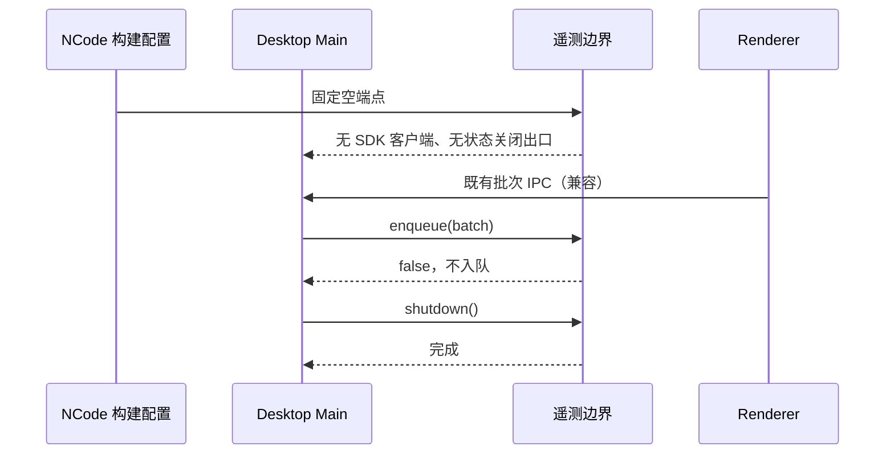

# Desktop telemetry boundary

产品规则见根目录 `ncode-feature.md` 的遥测与桌面构建依赖归属条目。

Main 的 ARMS 客户端只由此模块按构建期端点加载。NCode 构建期端点固定为空，因此客户端是 undefined；环境变量不能开启 SDK。类型引用不构成运行时加载。Browser SDK 不经过此 Main 端口。

关闭出口无状态，不检查或保存输入，enqueue 一律返回 false。flush 和 shutdown 可重复调用并立即完成；没有队列、采样、持久化或网络副作用。Main 将既有 IPC 批次送入这个出口，协议与本地运行事件的所有者不变。

